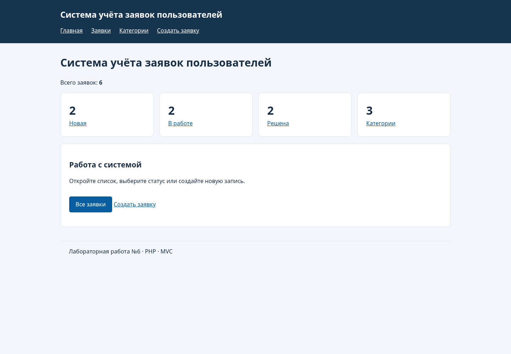
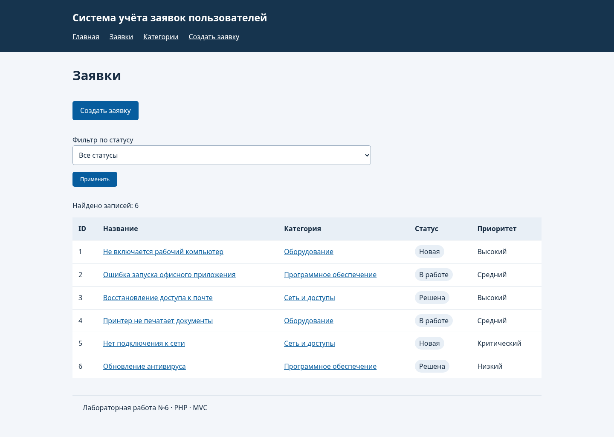
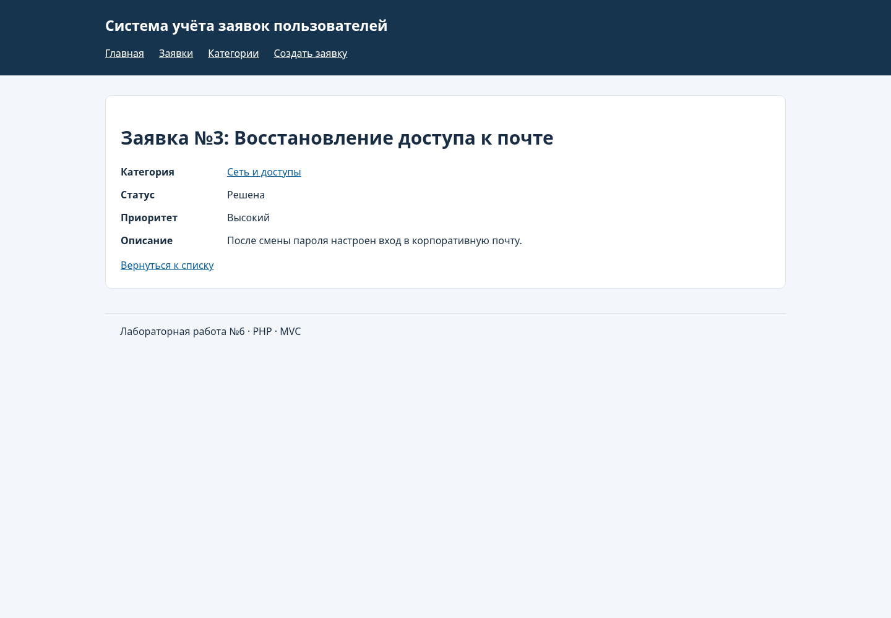
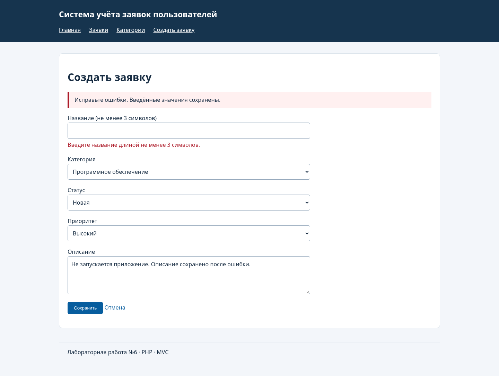
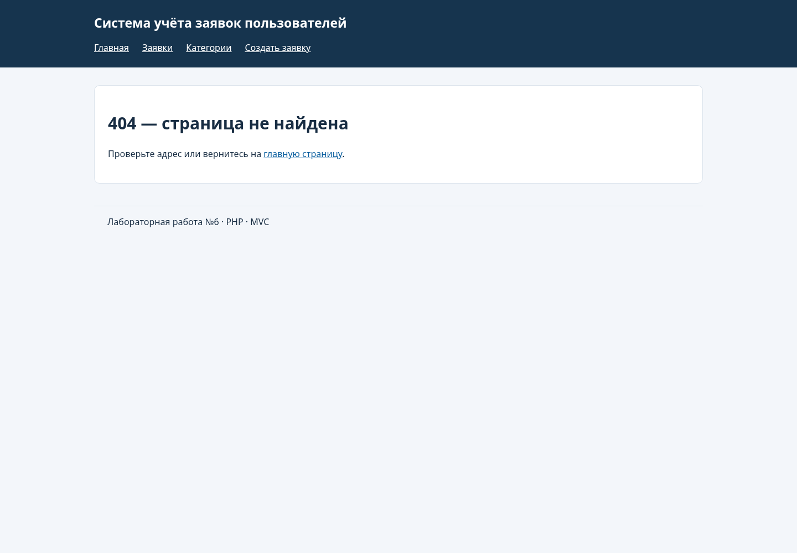
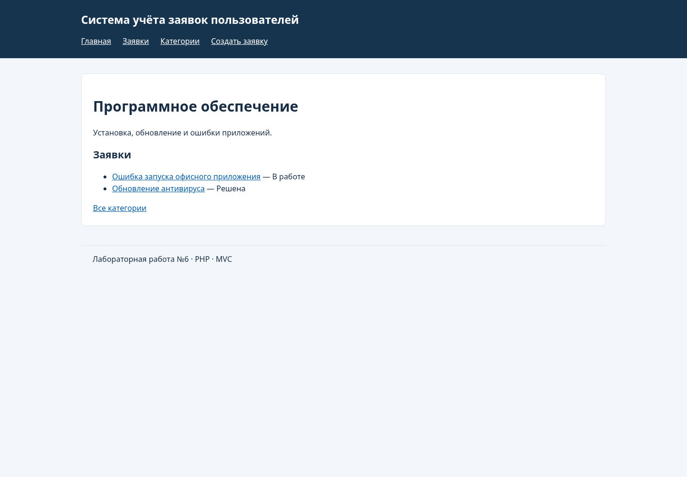
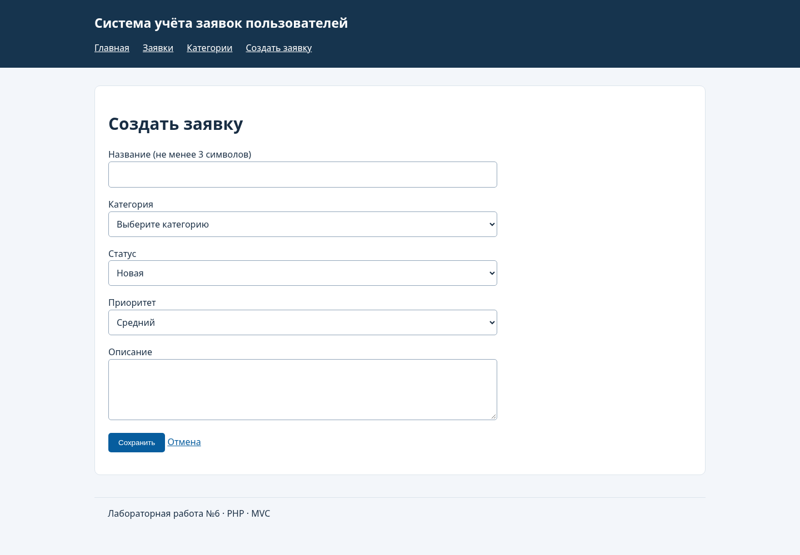
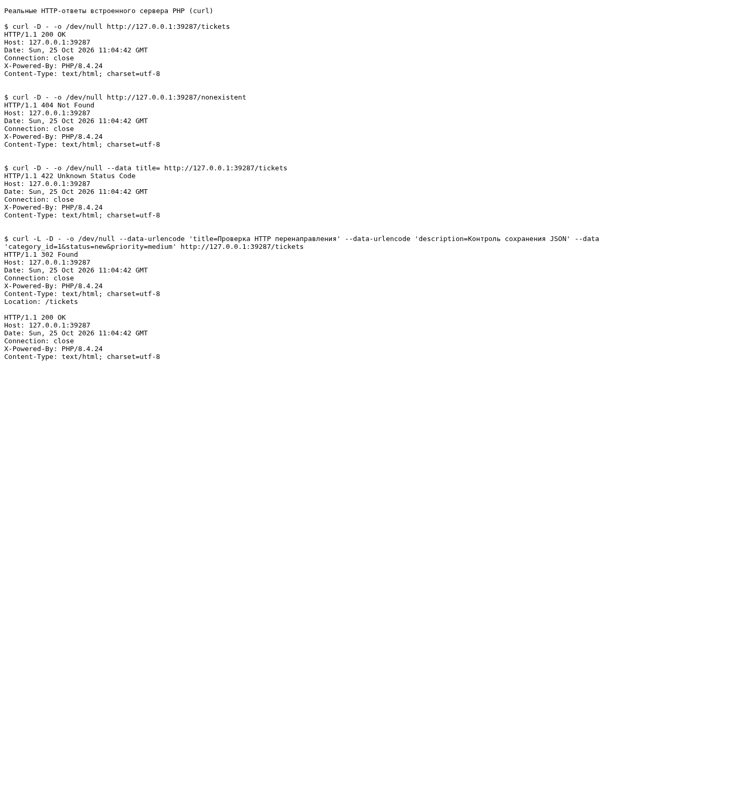

# Лабораторная работа №6. Разработка серверной части приложения

## 1. Цель работы

Изучить основы разработки серверной части веб-приложений на PHP, реализовать единую точку входа, маршрутизацию HTTP-запросов и контроллеры по архитектуре MVC. Разработать приложение на предметной области лабораторной работы №1 — **«Система учёта заявок пользователей»**, вариант 6.

## 2. Исходное состояние и выполненные изменения

Работа выполнена на основе существующей ветки `isit-6` репозитория `Qweflix/isit-lab1`. Перед разработкой изучены `main`, ЛР1, ЛР3, ЛР5 и различия между `main` и `isit-6`. Ветка `main` не изменялась и не сливалась в рабочую ветку.

В `isit-6` находились README, пять командных задач в `tasks.json`, три участника в `members.json` и пустые файлы-маркеры. PHP-файлов, готового маршрутизатора, моделей, контроллеров и шаблонов в этой ветке не было. Описанная в методичке готовая PHP-заготовка отдельным файлом не предоставлена, поэтому отсутствующие файлы созданы по её структуре и механизму MVC. Исходные README и JSON без изменения содержимого сохранены в [docs/original](docs/original); действующее приложение их не использует.

Первоначальная карточка «управление командными задачами» не соответствовала предметной области ЛР1. Сначала реализован пример «задачи — проекты» и выполнены проверки шага 4: [24 HTTP-сценария](docs/baseline-http.md). Этот этап сохранён коммитом `cff411f` до переноса. Затем пример полностью перенесён на заявки и категории техподдержки. Результат подготовлен в ветке `lab6-completion`, основанной на `origin/isit-6`, для сохранения именно в `isit-6`.

## 3. Структура проекта

```text
isit lab6/
├── README.md
├── src/
│   ├── public/                 # Единственный общедоступный каталог
│   │   ├── index.php           # Единая точка входа
│   │   └── css/style.css       # Оформление страниц
│   ├── app/
│   │   ├── autoload.php        # Автозагрузка классов App по пространству имён
│   │   ├── helpers.php         # e, view, redirect, notFound, config, input
│   │   ├── Core/Router.php     # Регистрация и диспетчеризация маршрутов
│   │   ├── Controllers/       # HomeController, TicketController, CategoryController
│   │   ├── Models/            # TicketRepository, CategoryRepository, JsonStorage
│   │   └── Views/             # home, tickets, categories, layout, errors
│   ├── routes/web.php         # Семь маршрутов приложения
│   ├── config/app.php         # Название системы, статусы и приоритеты
│   └── storage/               # tickets.json, categories.json
├── images/                    # Реальные скриншоты PHP-приложения
└── docs/                      # Проверки HTTP, HAR, журналы и исходные материалы
```

Каталог `public` отделён от исходного кода и JSON. Например, запрос `/storage/tickets.json` получает 404. База данных, REST API и сторонние PHP-фреймворки в обязательной части не используются.

## 4. Механизм маршрутизации

`public/index.php` определяет `BASE_PATH`, `APP_PATH`, `STORAGE_PATH`, подключает автозагрузку и вспомогательные функции. Затем создаёт `Router`, подключает `routes/web.php` и вызывает `dispatch()` с HTTP-методом и URI запроса.

Методы `get()` и `post()` вызывают `add()`, который сохраняет метод, шаблон адреса и обработчик. В `dispatch()` из URI выделяется путь без query-параметров. Цикл пропускает маршруты с другим HTTP-методом, преобразует `{id}` в регулярное выражение и проверяет полный путь. При совпадении создаётся контроллер и вызывается его метод с именованным параметром `id`. После вызова поиск прекращается. Если совпадений нет, `notFound()` устанавливает код 404 и выводит HTML-страницу ошибки.

Конкретный маршрут `/tickets/create` расположен **выше** `/tickets/{id}`. Благодаря этому слово `create` открывает форму, а не рассматривается как номер заявки. `POST /categories` возвращает 404: для этого адреса зарегистрирован только GET.

| Метод | Адрес | Обработчик | Ответ и коды |
| --- | --- | --- | --- |
| GET | `/` | `HomeController::index` | HTML: статистика, 200 |
| GET | `/tickets` | `TicketController::index` | HTML: список, фильтр `?status=...`, 200 |
| GET | `/tickets/create` | `TicketController::create` | HTML: форма, 200 |
| POST | `/tickets` | `TicketController::store` | Поля формы → 302 и `Location: /tickets`; при ошибках HTML и 422 |
| GET | `/tickets/{id}` | `TicketController::show` | HTML: заявка и категория, 200; отсутствующая заявка — 404 |
| GET | `/categories` | `CategoryController::index` | HTML: категории, 200 |
| GET | `/categories/{id}` | `CategoryController::show` | HTML: категория и её заявки, 200; отсутствующая категория — 404 |

Все страницы возвращаются как `text/html; charset=utf-8`. Непредвиденная ошибка приложения обрабатывается точкой входа: код 500, страница без технических подробностей, исключение в журнале сервера.

## 5. Контроллеры и взаимодействие MVC

**HomeController** получает заявки и категории через модели, считает общее число заявок и количество по статусам. На главной странице расположены четыре карточки: новые, в работе, решённые и категории; отдельно показано общее число заявок.

**TicketController** реализует `index`, `show`, `create`, `store`. Список можно отфильтровать по статусу. При просмотре проверяется числовой ID, затем загружаются заявка и связанная категория. Отсутствующая запись даёт 404. Неизвестное значение фильтра даёт пустой список с кодом 200.

**CategoryController** показывает список категорий и карточку выбранной категории. Метод модели `byCategory()` возвращает только заявки с соответствующим `category_id`.

Модели читают и сохраняют JSON через `JsonStorage`. Контроллеры передают массивы данных в `view()`, а шаблоны формируют HTML. Общие шапка и подвал находятся в `Views/layout`. Пользовательские значения выводятся через `e()` с `htmlspecialchars`, включая название, описание и сохранённые поля формы.

Цепочка запроса:

```text
GET /tickets/3 → public/index.php → Router::dispatch()
→ TicketController::show('3') → TicketRepository::find(3)
→ CategoryRepository::find(category_id) → Views/tickets/show.php → HTML, 200
```

При создании заявки `store()` читает только ожидаемые поля, проверяет название (не менее трёх символов), непустое описание, существующую категорию, допустимые статус и приоритет. Неверные или переданные массивом поля не вызывают PHP-ошибку. При ошибках возвращается 422, сообщения показаны красным, корректные введённые значения остаются в форме. При успехе `category_id` приводится к целому числу, модель создаёт следующий числовой `id`, записывает JSON и выполняется перенаправление 302 на список. Следующий GET возвращает 200 — схема Post/Redirect/Get предотвращает повторную отправку формы при обновлении списка.

Чтение JSON выполняется под общей блокировкой, а чтение–вычисление ID–запись — под одной исключительной блокировкой `flock`. Ошибки чтения, JSON и записи не маскируются успешным перенаправлением.

## 6. Предметная область и перенос

Источник: [описание системы учёта заявок в ЛР1](../isit%20lab1/README.md). Заявка относится к категории проблемы: оборудование, ПО, сеть и доступы. Для объёма ЛР6 выбраны две связанные сущности; остальные объекты полной системы ЛР1 не добавлялись в учебное приложение.

| Что определить | Значение |
| --- | --- |
| Основная сущность (рус.) | Заявка пользователя в техподдержку |
| Основная сущность (англ., ед. / мн.) | `ticket` / `tickets` |
| Связанная сущность (рус.) | Категория обращения |
| Связанная сущность (англ., ед. / мн.) | `category` / `categories` |
| Поля основной сущности: 6, включая ID | `id`, `category_id`, `title`, `description`, `status`, `priority` |
| Поля связанной сущности: 3, включая ID | `id`, `title`, `description` |
| Связь | `tickets.category_id` → `categories.id` |
| Поле фильтра и 3 значения | `status`: `new` — «Новая», `in_progress` — «В работе», `done` — «Решена» |
| Допустимые приоритеты | `low`, `medium`, `high`, `critical` |
| Начальные данные | 6 заявок, 3 категории; числовые ID |

Переименованы контроллеры, модели, каталоги шаблонов, переменные, поля связи и метод `byProject()` → `byCategory()`. Заменены JSON-данные, семь маршрутов, форма, проверки, подписи, ссылки, статистика главной страницы и название системы; поле срока выполнения заменено описанием проблемы. Механизм MVC, `Router`, автозагрузка, функции и общие шаблоны ошибок сохранены.

После переноса повторена таблица шага 4 и выполнены дополнительные проверки: [30 HTTP-сценариев](docs/final-http.md). В действующем `src/` отсутствуют сущности и подписи демонстрационного примера; `/tasks`, `/tasks/create`, `/tasks/3`, `/projects`, `/projects/2`, `/members` возвращают 404. Упоминания старой области сохранены только в документации и истории этапа до переноса.

## 7. Результаты проверки HTTP

Проверка выполнена на **PHP 8.4.24**, что соответствует требованию PHP 8.2+. Доступны расширения `json` и `mbstring`. Синтаксис всех **22 PHP-файлов** проверен командой `php -l`. Использован настоящий встроенный сервер PHP; тесты выполнялись на временных копиях данных, исходные шесть заявок не изменялись.

| Проверка итогового приложения | Ожидается | Фактически | Содержимое / результат |
| --- | --- | --- | --- |
| GET `/` | 200 | 200 | Четыре карточки статистики и ссылки |
| GET `/tickets` | 200 | 200 | Список заявок |
| GET `/tickets?status=done` | 200 | 200 | Только решённые заявки |
| GET `/tickets/3` | 200 | 200 | Заявка №3 и название категории |
| GET `/tickets/999` | 404 | 404 | Страница ошибки |
| GET `/tickets/create` | 200 | 200 | Именно форма создания |
| POST `/tickets`, пустая форма | 422 | 422 | Сообщения валидации |
| POST `/tickets`, пустое название, остальные поля заполнены | 422 | 422 | Ошибка названия, значения сохранены |
| POST `/tickets`, корректная форма | 302, затем 200 | 302, затем 200 | `Location: /tickets`, новая запись в списке и JSON |
| GET `/categories` | 200 | 200 | Карточки категорий |
| GET `/categories/2` | 200 | 200 | Категория и только связанные заявки |
| GET `/nonexistent` | 404 | 404 | Страница ошибки |
| POST `/categories` | 404 | 404 | Нет маршрута для POST |

Дополнительно проверены неизвестные ID и статусы, неверная категория и приоритет, пустое описание, массив вместо строкового поля, экранирование `<script>` и HTML, недоступность JSON по URL, отсутствие изменений JSON после ошибочных форм и отключение старых адресов. В журнале итоговых HTTP-проверок ошибок и предупреждений PHP не обнаружено. Полные результаты: [таблица](docs/final-http.md), [журнал PHP](docs/final-http.log).

В Chromium проверены переходы, отправка формы с ошибкой и успешное создание заявки через браузер. Сохранены [результаты](docs/browser-results.md), [сетевой HAR](docs/browser.har) и [журнал браузерного запуска PHP](docs/browser-server.log). Проверка в Firefox, Safari и отдельных версиях PHP 8.2/8.3 не выполнялась. Отдельный сценарий принудительного сбоя диска для ответа 500 не запускался.

## 8. Демонстрация работы

Скриншоты получены с работающего PHP-приложения автоматически через Chromium и Playwright, без макетов и подмены ответов.

### Главная страница



### Список заявок



### Просмотр заявки и связанной категории



### Ошибки формы: HTTP 422 и сохранённое описание



### Страница 404



### Категория и её заявки



### Форма создания



### Реальные HTTP-ответы и перенаправление



Последний скриншот показывает [подлинный вывод curl](docs/http-headers.txt), открытый как текст в браузере. Это HTTP-проверки, а не снимок вкладки DevTools Network. Запросы браузера, включая POST и перенаправление 302 → 200, сохранены в HAR; вкладку Network можно открыть вручную на защите.

## 9. Запуск и демонстрация

Требуются PHP **8.2 или выше**, расширения `json` и `mbstring`. Composer и другие зависимости приложения не нужны. Файл `src/storage/tickets.json` должен быть доступен для чтения и записи пользователю, который запускает PHP; файл категорий — для чтения.

Из корня репозитория:

```bash
php -v
php -m
cd "isit lab6/src"
php -S localhost:8000 -t public
```

Открыть [http://localhost:8000](http://localhost:8000). Остановка сервера — `Ctrl+C`. Изменения PHP подхватываются при следующем запросе, перезапуск не требуется.

В текущей облачной среде PHP подготовлен отдельно, вне репозитория. Эквивалентный запуск здесь:

```bash
cd "/workspace/isit-lab1/isit lab6/src"
/tmp/lab6-runtime/bin/php -S localhost:8000 -t public
```

Для автоматического повторения проверок из корня репозитория (нужны Python 3 и PHP):

```bash
python3 "isit lab6/docs/check_http.py"
```

В данной облачной среде:

```bash
PHP_BIN=/tmp/lab6-runtime/bin/php python3 "isit lab6/docs/check_http.py"
```

Тесты создают отдельный встроенный сервер на свободном локальном порту, копируют `src` во временный каталог и удаляют тестовую копию после завершения. Опция `--demo` предназначена для запуска на промежуточном коммите `cff411f`, где ещё действуют `/tasks` и `/projects`. Для повторного получения скриншотов предусмотрен `docs/capture_browser.py`: дополнительно нужны Playwright и Chromium; они не требуются для работы приложения.

Порядок демонстрации преподавателю:

1. Открыть главную страницу, объяснить подсчёт по трём статусам и числу категорий.
2. Открыть список и выбрать фильтр «Решена»: останутся заявки №3 и №6.
3. Перейти в заявку №3, затем в её категорию и показать связанные заявки.
4. Открыть форму, ввести описание и выбрать категорию, оставив название пустым. Отправить: получить 422 и сохранённые значения.
5. Заполнить название и отправить форму: показать 302 → 200 во вкладке Network (F12, Preserve log), запись в списке и `storage/tickets.json`.
6. Открыть `/tickets/999` и `/nonexistent`, показать 404. Проверить, что старые `/tasks` и `/projects` также дают 404.
7. Показать `routes/web.php`, `Router::dispatch`, контроллер, модель и шаблон. [Краткие ответы на контрольные вопросы](docs/defense.md).

## 10. Вывод

В ходе лабораторной работы реализовано серверное приложение на PHP по архитектуре MVC. Созданы единая точка входа, маршрутизатор с параметрами URL, три контроллера и HTML-представления. Организованы валидация формы, безопасный вывод данных, сохранение заявок в JSON и перенаправление после успешного создания. Пример проверен до переноса, затем приложение перенесено на систему учёта заявок пользователей из ЛР1 и повторно проверено по HTTP и в браузере.

[Полный список изменений и сохранение в isit-6](docs/changes.md).

Соответствие шагам 0–6 и заданиям методички приведено в [матрице требований](docs/requirements.md). Задания повышенной сложности и REST API не включены в обязательный вариант.
