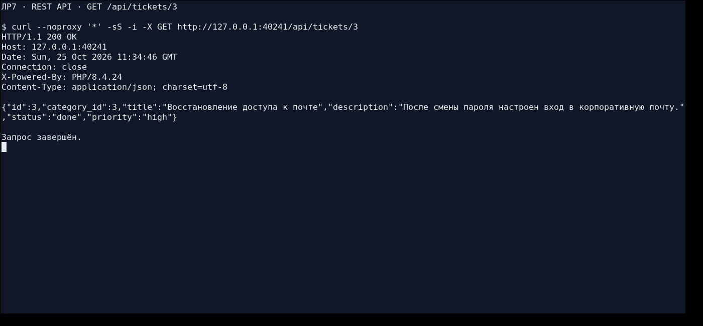
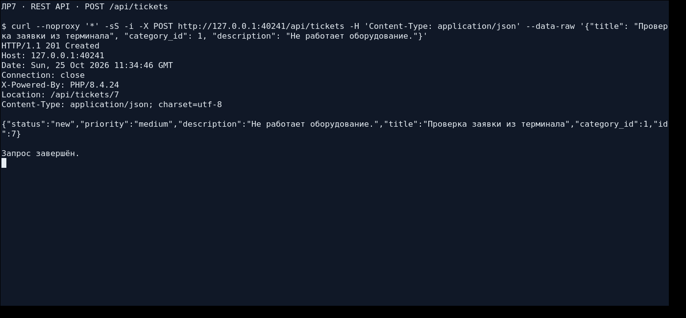
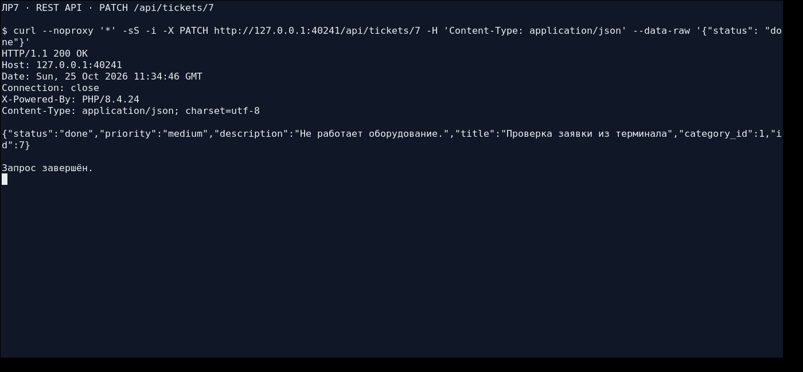
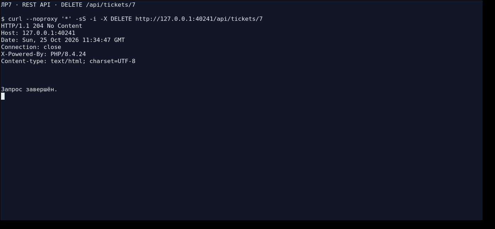
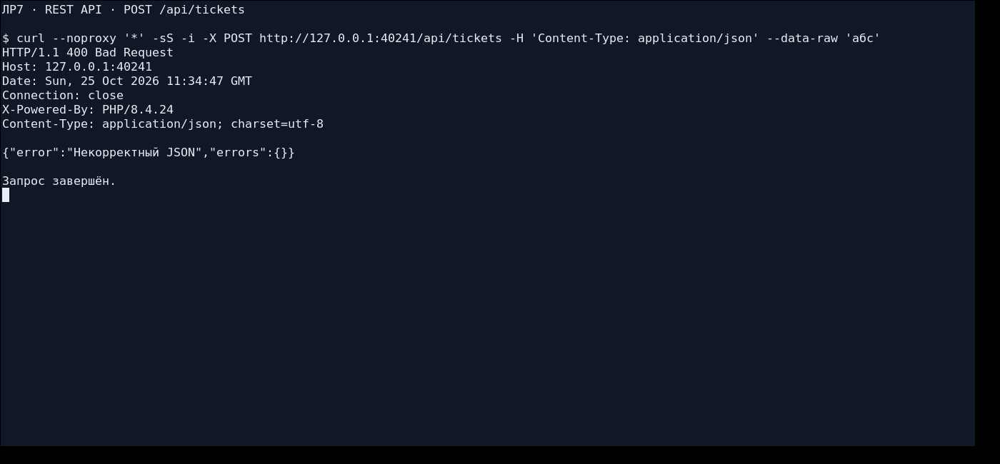
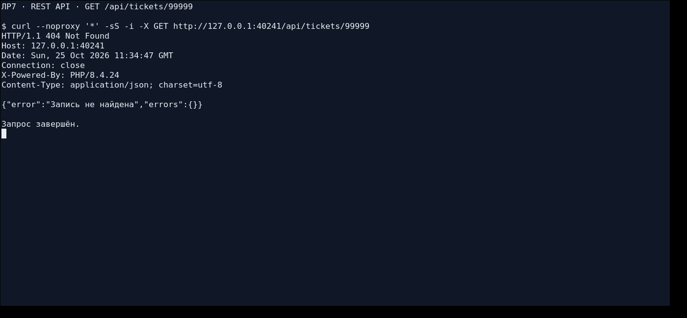
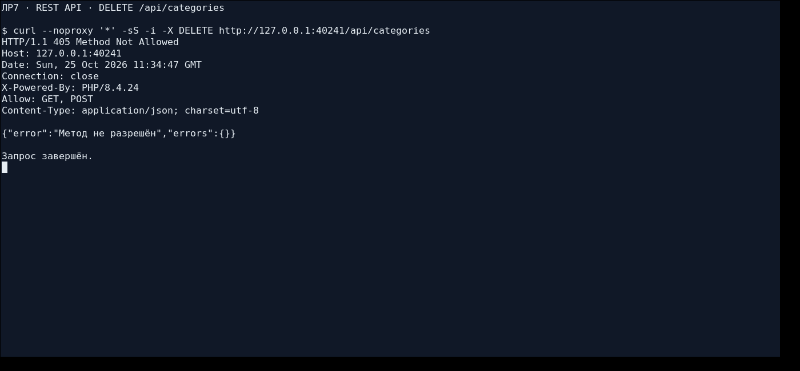
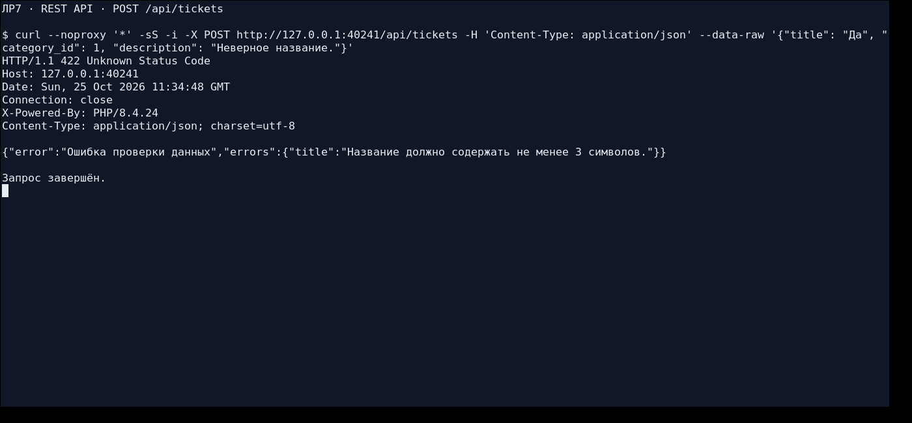
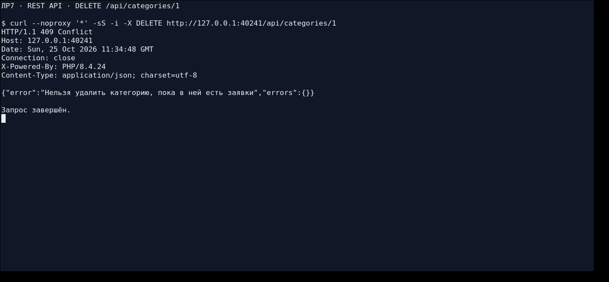

# Лабораторная работа №7. Проектирование REST API

## 1. Цель работы

Изучить принципы проектирования REST API, определить ресурсы информационной системы, реализовать CRUD с использованием HTTP-методов, подготовить документацию и проверить запросы.

Предметная область — **«Система учёта заявок пользователей»**, вариант 6 из ЛР1. Основная и связанная сущности сохранены из выполненной ЛР6: заявки и категории обращений. Третий ресурс — сотрудники поддержки.

## 2. Исходное состояние и этапы работы

Разработка выполнена в существующей ветке `isit-7` репозитория `Qweflix/isit-lab1`. В начале ветка содержала предыдущие лабораторные и не содержала ни каталога ЛР7, ни готовой PHP-заготовки, о которой говорится в методичке. Серверная часть подготовлена на основе собственного проверенного кода ЛР6; отсутствующие функции API и операции моделей реализованы по структуре методички. Содержимое предыдущих лабораторных и других веток не менялось.

Работа выполнена по этапам:

1. Подготовлены PHP-проект и [таблица трёх ресурсов примера](docs/resources-baseline.md), коммит `30f1ec4`.
2. Реализован пример «задачи — проекты — участники», выполнены [82 HTTP-проверки](docs/baseline-testing.md), сохранён коммит `de0f3ba` до переноса.
3. API и HTML-сайт перенесены на заявки, категории и сотрудников поддержки; выполнены [90 HTTP-проверок](docs/testing.md), коммит `357f7e1`.
4. Подготовлены полная документация 19 конечных точек, отчёт, реальные снимки терминала и проверка запуска из чистого клона.

## 3. Ресурсы и предметная область

| Ресурс | Адреса | Методы | Назначение | Поля JSON |
| --- | --- | --- | --- | --- |
| Заявки | `/api/tickets`, `/api/tickets/{id}` | GET, POST, PUT, PATCH, DELETE | CRUD, фильтры по статусу и категории, поиск по названию | id, category_id, title, description, status, priority |
| Категории | `/api/categories`, `/api/categories/{id}`, `/api/categories/{id}/tickets` | GET, POST, PUT, PATCH, DELETE | CRUD категорий и получение связанных заявок | id, title, description |
| Сотрудники поддержки | `/api/staff`, `/api/staff/{id}` | GET, POST, PUT, PATCH, DELETE | CRUD справочника сотрудников | id, name, email, role |

Полная карточка переноса находится в [docs/resources.md](docs/resources.md). В начальных JSON-файлах **6 заявок, 3 категории и 3 сотрудника**. ID — положительные целые числа; связь — `tickets.category_id` → `categories.id`. Названия классов и полей написаны на английском, сообщения об ошибках и HTML-интерфейс — на русском.

Статусы заявок: `new` — «Новая», `in_progress` — «В работе», `done` — «Решена». Приоритеты: `low`, `medium`, `high`, `critical`. Сотрудники представлены отдельным справочником; назначение исполнителя в заявку не добавлялось. Поле `role` обозначает должность, авторизация в работе не реализуется.

## 4. Структура и реализация

```text
isit lab7/
├── README.md
├── src/
│   ├── public/
│   │   ├── index.php                  # Единая точка входа, обработка 500
│   │   └── css/style.css
│   ├── app/
│   │   ├── autoload.php               # Автозагрузка классов App
│   │   ├── helpers.php                # HTML-функции и JSON-ответы/ошибки
│   │   ├── Core/Router.php            # GET/POST/PUT/PATCH/DELETE, 404/405
│   │   ├── Controllers/
│   │   │   ├── Api/                   # TicketApiController, CategoryApiController,
│   │   │   │                          # StaffApiController
│   │   │   └── ...                    # Три HTML-контроллера сайта ЛР6
│   │   ├── Models/                    # JsonRepository и три репозитория ресурсов
│   │   └── Views/                     # HTML-сайт и страницы ошибок
│   ├── routes/web.php                # 19 API-маршрутов + 7 HTML-маршрутов
│   ├── config/app.php                # Название системы, статусы, приоритеты
│   └── storage/                      # tickets.json, categories.json, staff.json
├── images/                           # 9 настоящих скриншотов XTerm с curl
└── docs/
    ├── api.md                        # Все endpoints, параметры, запросы и ответы
    ├── testing.md                    # Таблица 90 итоговых проверок
    ├── final-transcript.json          # Фактические запросы, заголовки и тела ответов
    ├── baseline-testing.md            # Проверки примера до переноса
    ├── screenshots.md                # Происхождение снимков и ссылки на ответы
    ├── check_api.py                   # Повторяемые проверки через curl
    ├── capture_terminal.py            # Съёмка настоящего терминала
    ├── requirements.md                # Соответствие методичке
    └── defense.md                     # Ответы на контрольные вопросы
```

`Router` сопоставляет путь и HTTP-метод, передаёт URL-параметры контроллеру. Для путей `/api` неизвестный адрес возвращает JSON и 404, а существующий путь с другим методом — JSON, 405 и заголовок `Allow`. Для HTML-страниц сохранено поведение ЛР6.

Каждый API-контроллер содержит `index`, `show`, `store`, `update`, `destroy`. `CategoryApiController::tickets` дополнительно возвращает заявки категории. `clean()` оставляет только разрешённые поля и отбрасывает попытку задать `id`; `validate()` проверяет типы, обязательные значения и связь с категорией. Все ошибки полей возвращаются одновременно.

`json_input()` читает тело как JSON-объект, `json_response()` формирует JSON в UTF-8 и завершает обработку, `json_error()` возвращает единый объект `{error, errors}`, `no_content()` отправляет 204 без тела. Непредвиденные исключения в `/api` дают JSON с кодом 500; технические сведения записываются в журнал, а не в ответ клиенту.

Три репозитория наследуют `JsonRepository` с операциями `all`, `find`, `add`, `update`, `delete`. Чтение выполняется под общей блокировкой файла, изменения — под исключительной; чтение, вычисление следующего ID и запись происходят под одной блокировкой. Данные хранятся в JSON, без базы данных и сторонних PHP-фреймворков.

## 5. Обзор REST API

| Метод | URL | Назначение | Успешный код |
| --- | --- | --- | --- |
| GET | `/api/tickets` | Список и фильтры status/category_id/q | 200 |
| GET | `/api/tickets/{id}` | Одна заявка | 200 |
| POST | `/api/tickets` | Создание заявки | 201 + Location |
| PUT / PATCH | `/api/tickets/{id}` | Изменение заявки | 200 |
| DELETE | `/api/tickets/{id}` | Удаление заявки | 204, без тела |
| GET | `/api/categories` | Список категорий | 200 |
| GET | `/api/categories/{id}` | Одна категория | 200 |
| POST | `/api/categories` | Создание категории | 201 + Location |
| PUT / PATCH | `/api/categories/{id}` | Изменение категории | 200 |
| DELETE | `/api/categories/{id}` | Удаление категории без заявок | 204, без тела |
| GET | `/api/categories/{id}/tickets` | Заявки выбранной категории | 200 |
| GET | `/api/staff` | Список сотрудников | 200 |
| GET | `/api/staff/{id}` | Один сотрудник | 200 |
| POST | `/api/staff` | Создание сотрудника | 201 + Location |
| PUT / PATCH | `/api/staff/{id}` | Изменение сотрудника | 200 |
| DELETE | `/api/staff/{id}` | Удаление сотрудника | 204, без тела |

По условию методички **PUT и PATCH обрабатываются одинаково: изменяются только присланные поля**. Остальные значения сохраняются. Стандартная семантика полной замены PUT здесь намеренно упрощена.

При создании заявки обязательны `title` длиной от трёх символов, числовой `category_id` существующей категории и непустое `description`. Статус по умолчанию — `new`, приоритет — `medium`. Для категории обязательно название от трёх символов; для сотрудника — имя от трёх символов и корректный email, должность по умолчанию — «Инженер».

| Код ошибки | Причина |
| --- | --- |
| 400 | Некорректный JSON или вместо объекта переданы массив, скаляр, пустое тело |
| 404 | Неизвестный адрес или ID |
| 405 | Метод не поддерживается для существующего пути; возвращается Allow |
| 409 | Попытка удалить категорию с заявками |
| 422 | Неверные типы, значения полей или фильтров |
| 500 | Ошибка сервера или хранилища |

Пример ошибки:

```json
{"error":"Ошибка проверки данных","errors":{"title":"Название должно содержать не менее 3 символов."}}
```

Полная документация каждой из **19 конечных точек**, включая отдельные PUT и PATCH, находится в [docs/api.md](docs/api.md).

## 6. Примеры запросов и ответов

Примеры операций ниже выполняются последовательно после запуска на начальных данных. POST вернёт ID 7; если данные уже менялись, следует использовать ID и Location из фактического ответа.

### Чтение — GET

```bash
curl -i http://localhost:8000/api/tickets/3
```

Ответ **200**, JSON:

```json
{"id":3,"category_id":3,"title":"Восстановление доступа к почте","description":"После смены пароля настроен вход в корпоративную почту.","status":"done","priority":"high"}
```

Список решённых заявок: `GET /api/tickets?status=done`. Заявки категории: `GET /api/categories/2/tickets`.

### Создание — POST

```bash
curl -i -X POST http://localhost:8000/api/tickets \
  -H 'Content-Type: application/json' \
  --data '{"title":"Проверка создания через API","category_id":1,"description":"Приложение не открывается на рабочем месте."}'
```

Ответ **201**, `Location: /api/tickets/7`:

```json
{"status":"new","priority":"medium","description":"Приложение не открывается на рабочем месте.","title":"Проверка создания через API","category_id":1,"id":7}
```

### Обновление — PATCH

```bash
curl -i -X PATCH http://localhost:8000/api/tickets/7 \
  -H 'Content-Type: application/json' --data '{"status":"done"}'
```

Ответ **200**, остальные поля сохранены:

```json
{"status":"done","priority":"medium","description":"Приложение не открывается на рабочем месте.","title":"Проверка создания через API","category_id":1,"id":7}
```

### Обновление — PUT

```bash
curl -i -X PUT http://localhost:8000/api/tickets/7 \
  -H 'Content-Type: application/json' --data '{"status":"done"}'
```

Ответ **200** с тем же объектом, что в примере PATCH: отсутствующие поля не удаляются.

### Удаление — DELETE

```bash
curl -i -X DELETE http://localhost:8000/api/tickets/7
```

Ответ **204**, тело отсутствует. Следующий GET `/api/tickets/7` возвращает 404:

```json
{"error":"Запись не найдена","errors":{}}
```

## 7. Дополнительная возможность

Для домашней доработки реализован **поиск по названию**: `/api/tickets?q=компьютер`. Поиск выполняется без учёта регистра, включая кириллицу. Он совместим с фильтрами `status` и `category_id`; пустое совпадение возвращает `[]`, неверный тип `q` — 422. Пагинация, сортировка, авторизация и подключение клиента ЛР5 в эту работу не добавлялись.

## 8. Тестирование и скриншоты

Тесты действительно запущены на **PHP 8.4.24** с расширениями `json` и `mbstring` и встроенным сервером. Проверен синтаксис **26 PHP-файлов**. Выполнены **82 HTTP-сценария до переноса и 90 после переноса**; каждый API-запрос отправлялся `curl`. У каждого из трёх ресурсов проверены все пять CRUD-операций, оба метода обновления, коды и формат ответа.

Проверены 201 и `Location`, 204 и пустое тело, 405 и `Allow`, защита ID от изменения, неверные типы JSON, все ошибки полей, фильтрация, связь категорий и заявок, 409 при удалении непустой категории, поиск и ответы 404 на старых API-адресах. HTML-сайт продолжает работать.

Ответ 500 проверен намеренно: в тестовой копии временно испорчен JSON, сервер вернул безопасный JSON с 500, после восстановления файла снова ответил 200. Единственное ожидаемое исключение отражено в журнале; предупреждений и непредвиденных PHP-ошибок не обнаружено. Все тесты и съёмка выполнялись во временных копиях: исходные JSON не менялись.

- [Таблица 90 проверок](docs/testing.md).
- [Фактические запросы, заголовки и ответы](docs/final-transcript.json).
- [Проверка запуска из чистого клона](docs/clean-clone.md).
- [Скриншоты и происхождение доказательств](docs/screenshots.md).

Для снимков использован **настоящий XTerm**: команды curl выполнялись в терминале, экран захвачен через Xvfb и ImageMagick. Это реальные снимки, не макеты и не HTML-страницы с нарисованными ответами. Видны метод, адрес, JSON-тело запроса, заголовки и код ответа.

### Чтение: GET, 200



### Создание: POST, 201 и Location



### Обновление: PATCH, 200



### Удаление: DELETE, 204 без тела



### Ошибка JSON: 400



### Объект не найден: 404



### Метод не разрешён: 405 и Allow



### Ошибки полей: 422



### Категория содержит заявки: 409



Postman не использовался: методичка допускает curl. Отдельные версии PHP 8.2/8.3 и многопользовательская нагрузка не проверялись.

## 9. Запуск из чистого клона

Требования: **PHP 8.2+**, расширения `json` и `mbstring`, Git. Для приложения не нужны Composer, Python, Node.js, база данных или сторонние библиотеки. Файлы `src/storage/*.json` должны быть доступны для чтения и записи пользователю, запускающему PHP.

```bash
git clone --branch isit-7 --single-branch https://github.com/Qweflix/isit-lab1.git
cd "isit-lab1/isit lab7/src"
php -v
php -m
php -S localhost:8000 -t public
```

Открыть [сайт](http://localhost:8000) или [список заявок API](http://localhost:8000/api/tickets). Корнем веб-сервера является только `public`, исходный код и хранилище недоступны по прямому URL. Остановка — `Ctrl+C`.

В текущей облачной среде PHP находится вне репозитория; запуск здесь:

```bash
cd "/workspace/isit-lab7/isit lab7/src"
/tmp/lab6-runtime/bin/php -S localhost:8000 -t public
```

Автоматические проверки из корня репозитория требуют дополнительно Python 3 и curl:

```bash
python3 "isit lab7/docs/check_api.py"
```

В текущей среде:

```bash
PHP_BIN=/tmp/lab6-runtime/bin/php python3 "isit lab7/docs/check_api.py"
```

Тест создаёт временную копию `src`, запускает отдельный сервер на свободном порту и сохраняет таблицу, журнал и протокол. Опция `--demo` предназначена для проверки примера на коммите `de0f3ba`. `docs/capture_terminal.py` требует XTerm, Xvfb и ImageMagick только для повторной съёмки, они не являются зависимостями PHP-приложения.

## 10. Демонстрация преподавателю

1. Запустить PHP и показать GET списков `/api/tickets`, `/api/categories`, `/api/staff`.
2. Выполнить POST, взять ID из ответа и показать 201 с `Location`.
3. Выполнить GET этого объекта, PATCH и PUT, объяснить сохранение не переданных полей.
4. Удалить тестовую запись: показать 204 без тела, затем 404 при её чтении.
5. Повторить CRUD для категории без заявок и для сотрудника. Показать вложенный список `/api/categories/2/tickets`.
6. Показать 400 с телом `абс`, 422 с коротким названием, 405 при DELETE коллекции и 409 при удалении категории №1.
7. Показать фильтр, поиск по кириллице, документацию и таблицу проверок. Объяснить `Router`, `json_input`, `clean`, `validate` и `JsonRepository`.

[Ответы на контрольные вопросы](docs/defense.md). [Соответствие шагам и критериям методички](docs/requirements.md).

## 11. Вывод

В ходе лабораторной работы спроектировано и реализовано REST API системы учёта заявок. Для трёх ресурсов доступны чтение списка и отдельного объекта, создание, частичное обновление и удаление. Реализованы единый формат JSON-ошибок, проверка данных, защита связи категорий и заявок, фильтрация и поиск. Подготовлены полная документация конечных точек, таблица фактических проверок и реальные скриншоты терминала. API сохраняет данные в JSON и запускается встроенным сервером PHP.
