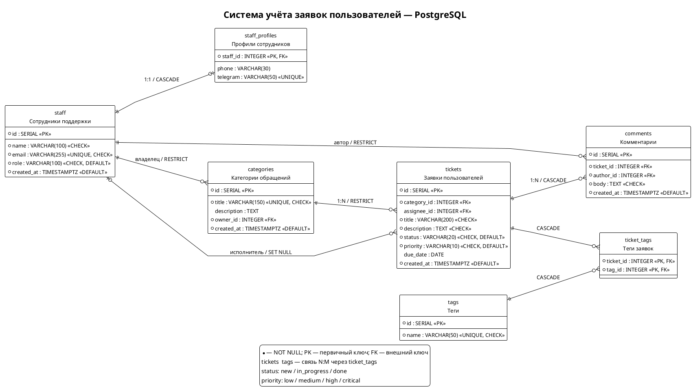
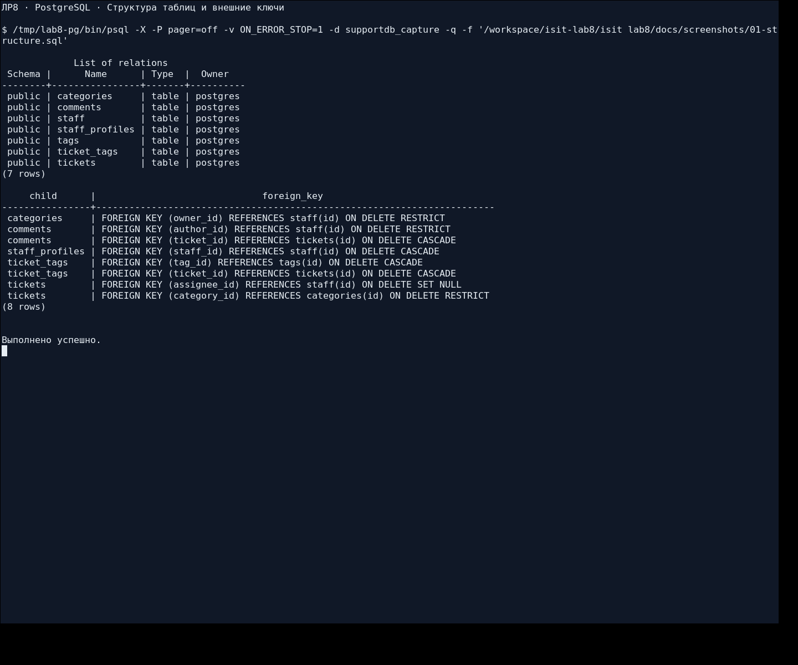
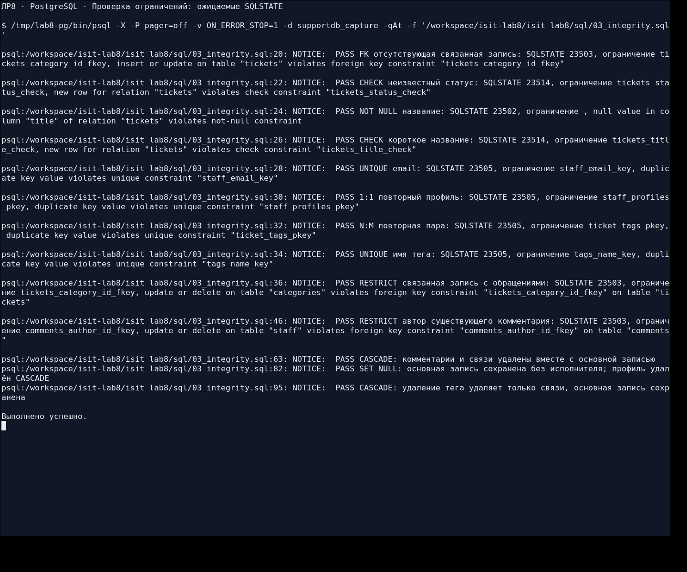
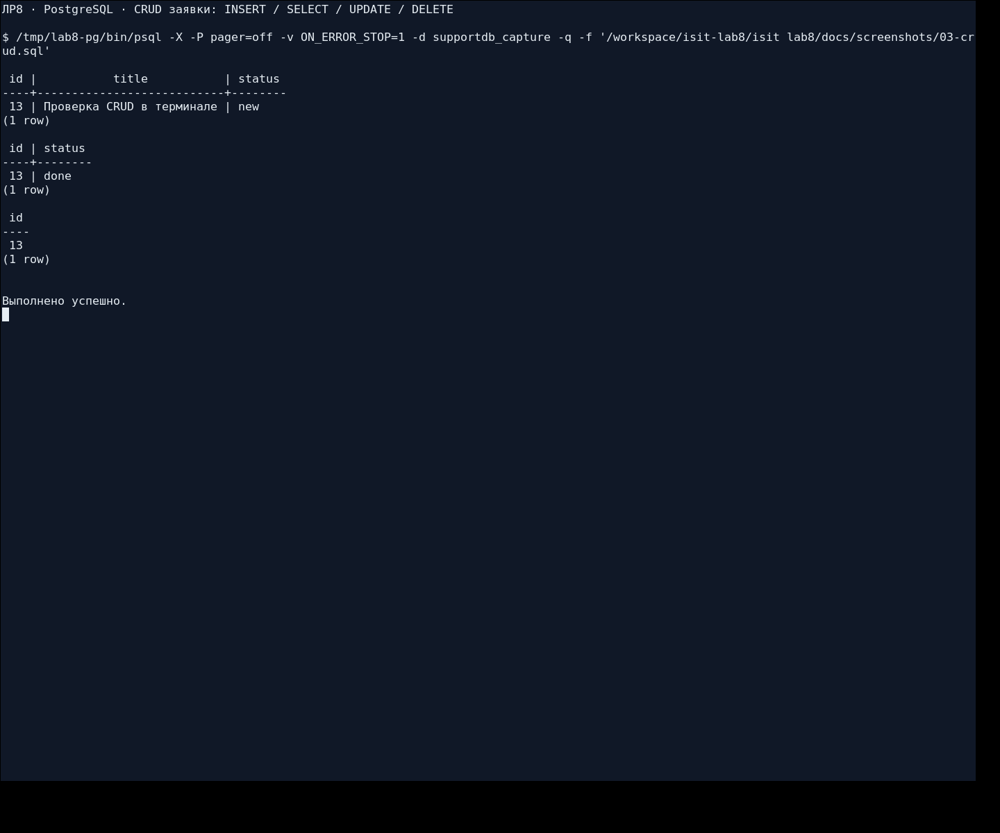
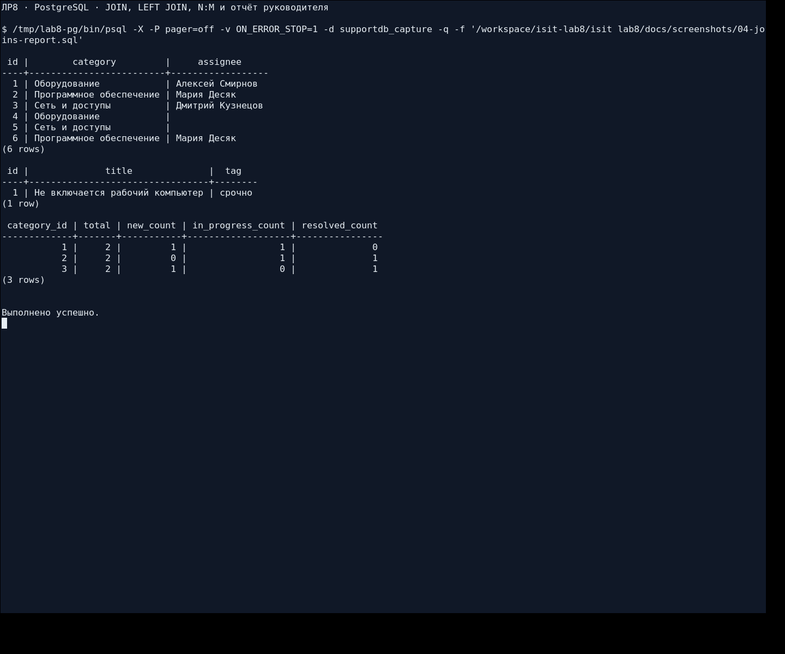
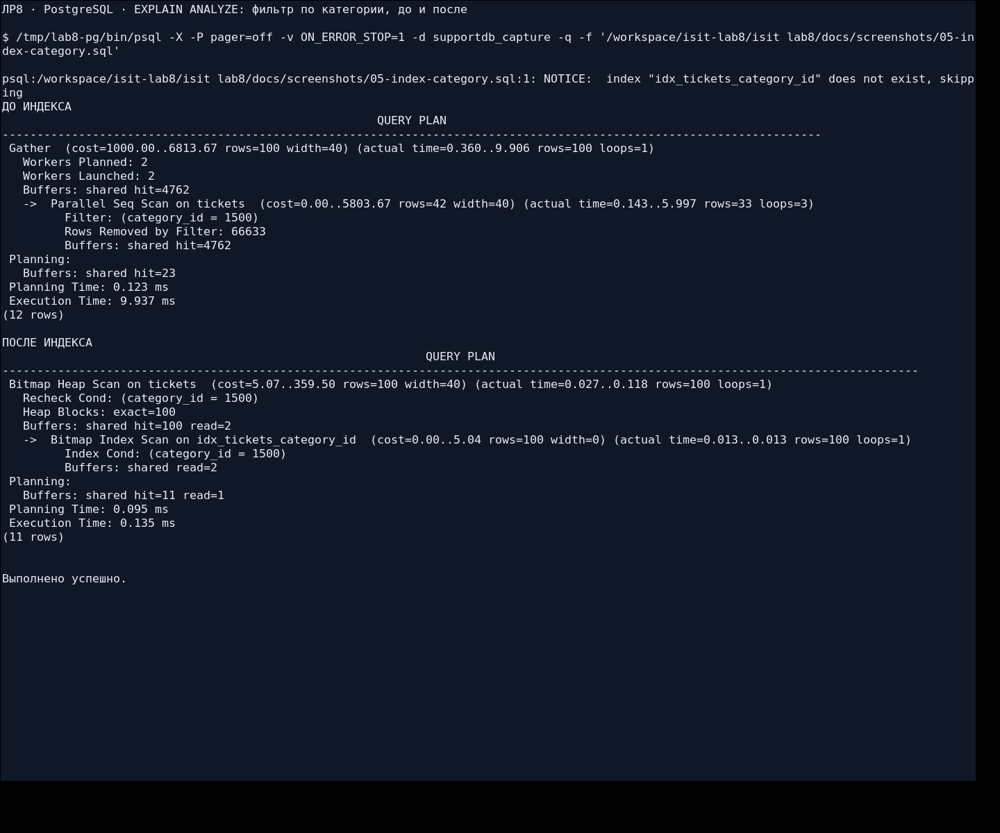
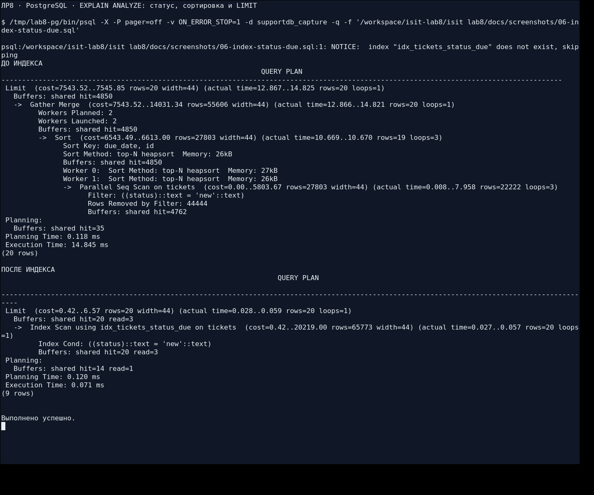

# Лабораторная работа №8. Проектирование и реализация базы данных

## 1. Цель работы

Спроектировать реляционную базу данных PostgreSQL для информационной системы, реализовать связи и ограничения целостности, подготовить SQL-запросы CRUD и сравнить планы выполнения запросов до и после создания индексов.

Предметная область — **«Система учёта заявок пользователей»**, вариант 6 из ЛР1. Основные ресурсы сохранены из ЛР7: заявки, категории обращений и сотрудники поддержки.

## 2. Исходное состояние и этапы работы

Работа выполнена в существующей ветке `isit-8` репозитория `Qweflix/isit-lab1`. До начала разработки в ней были предыдущие лабораторные; каталога ЛР8 и готовой SQL-заготовки не было. Скрипты созданы по структуре и требованиям приложенной методички. Содержимое других лабораторных и веток не менялось.

Сначала реализован пример «задачи — проекты — участники» из методички: семь таблиц, семь задач, проверки целостности, CRUD, нагрузка **500 000 задач и 1 000 000 комментариев**, четыре полезных индекса и два контрпримера. Пример проверен и сохранён коммитом **`bb79d91` до переноса**: [результаты](docs/baseline-testing.md), [полные журналы](docs/baseline).

После этого таблицы, поля, данные, проверки, запросы и индексы перенесены на систему учёта заявок. Выполнен весь цикл SQL 01–06 на собственной базе, построена ER-диаграмма и добавлено представление отчёта руководителя для домашней доработки. PHP и API ЛР7 к базе в этой работе не подключаются: это следующий этап курса.

## 3. Карточка предметной области

| Что определить | Система учёта заявок |
| --- | --- |
| Основная сущность | `tickets` — заявки пользователей |
| Связанная сущность, 1:N к основной | `categories` — категории обращений |
| Третья сущность из API ЛР7 | `staff` — сотрудники поддержки |
| Связь N:M | Заявки и теги, таблица `ticket_tags` |
| Связь 1:1 | Сотрудник и необязательный профиль, `staff_profiles` |
| Дополнительная сущность | `comments` — комментарии к заявкам |
| Поля основной сущности | `id`, `category_id`, `assignee_id`, `title`, `description`, `status`, `priority`, `due_date`, `created_at` |
| Статусы | `new` — новая, `in_progress` — в работе, `done` — решена |
| Приоритеты | `low`, `medium`, `high`, `critical` |
| Основные проверки | Название от 3 символов, непустое описание, допустимые статус и приоритет, существующая категория и сотрудник |

Сохранены исходные шесть полей заявок ЛР7; для реляционной модели добавлены необязательный исполнитель, срок и время создания. Категория получила ответственного сотрудника `owner_id`. В следующей работе при подключении API потребуется учитывать расширенную схему; действующий API ЛР7 здесь не изменяется.

## 4. Структура проекта

```text
isit lab8/
├── README.md
├── docker-compose.yml              # PostgreSQL 16, база supportdb
├── sql/
│   ├── 01_schema.sql               # Семь таблиц и ограничения
│   ├── 02_seed.sql                 # Начальные данные
│   ├── 03_integrity.sql            # Проверки ограничений и ON DELETE
│   ├── 04_crud.sql                 # CRUD, JOIN, N:M, GROUP BY
│   ├── 05_test_data.sql            # 200 000 заявок и 400 000 комментариев
│   ├── 06_optimization.sql         # Четыре индекса и два контрпримера
│   └── 07_report.sql               # Дополнительно: представление отчёта
├── diagrams/
│   ├── src/er.puml                 # Исходник PlantUML
│   └── images/er.png               # Реальный экспорт диаграммы
├── images/                        # Шесть снимков терминала с PostgreSQL
└── docs/
    ├── schema.md                   # Все поля, типы и ограничения из PostgreSQL
    ├── testing.md                  # Фактические результаты проверок
    ├── final/                      # Журналы, планы до/после, метаданные схемы
    ├── baseline/                   # Проверенный пример до переноса
    ├── screenshots.md              # Происхождение снимков
    ├── check_database.py            # Повторяемая проверка SQL 01–07
    ├── capture_database.py          # Захват настоящего XTerm с psql
    ├── requirements.md              # Соответствие методичке
    └── defense.md                   # Контрольные вопросы
```

## 5. ER-диаграмма



[Исходник PlantUML](diagrams/src/er.puml). PNG получен локальным запуском PlantUML и Graphviz. Имена таблиц, наборы полей и восемь внешних связей сопоставлены с метаданными созданной PostgreSQL.

## 6. Таблицы, поля и ограничения

В базе **7 таблиц, 7 первичных и 8 внешних ключей**. Ключ `staff_profiles.staff_id` одновременно является первичным и внешним, а в `ticket_tags` используется составной первичный ключ.

| Таблица | Поля и типы | Основные ограничения |
| --- | --- | --- |
| `staff` | `id SERIAL`, `name VARCHAR(100)`, `email VARCHAR(255)`, `role VARCHAR(100)`, `created_at TIMESTAMPTZ` | PK; имя от 3 символов; email NOT NULL, UNIQUE и CHECK формата; непустая должность; значения по умолчанию для role и created_at |
| `staff_profiles` | `staff_id INTEGER`, `phone VARCHAR(30)`, `telegram VARCHAR(50)` | staff_id — PK и FK; telegram UNIQUE; телефон и telegram необязательны |
| `categories` | `id SERIAL`, `title VARCHAR(150)`, `description TEXT`, `owner_id INTEGER`, `created_at TIMESTAMPTZ` | PK; title NOT NULL, UNIQUE, от 3 символов; owner_id — обязательный FK; description допускает NULL |
| `tickets` | `id SERIAL`, `category_id INTEGER`, `assignee_id INTEGER`, `title VARCHAR(200)`, `description TEXT`, `status VARCHAR(20)`, `priority VARCHAR(10)`, `due_date DATE`, `created_at TIMESTAMPTZ` | PK; обязательная категория; необязательные исполнитель и срок; CHECK названия, описания, статуса и приоритета; DEFAULT new/medium и время создания |
| `comments` | `id SERIAL`, `ticket_id INTEGER`, `author_id INTEGER`, `body TEXT`, `created_at TIMESTAMPTZ` | PK; два обязательных FK; непустой body; DEFAULT времени создания |
| `tags` | `id SERIAL`, `name VARCHAR(50)` | PK; имя NOT NULL, UNIQUE, непустое |
| `ticket_tags` | `ticket_id INTEGER`, `tag_id INTEGER` | Оба поля NOT NULL и FK; составной PK не допускает повторной пары |

[Полная таблица каждого поля с NULL, DEFAULT и точными определениями ограничений](docs/schema.md) получена из `information_schema` и `pg_constraint`, а не составлена по предположениям. Временные метки имеют тип `TIMESTAMPTZ` для хранения момента времени; `SERIAL` создаёт целочисленный столбец с последовательностью.

### Связи и поведение при удалении

| Внешний ключ | Связь | ON DELETE | Причина |
| --- | --- | --- | --- |
| `staff_profiles.staff_id` → `staff.id` | 1:1, профиль необязателен | CASCADE | Профиль не существует без сотрудника |
| `categories.owner_id` → `staff.id` | 1:N | RESTRICT | Нельзя удалить ответственного за категорию |
| `tickets.category_id` → `categories.id` | 1:N | RESTRICT | Категорию нельзя удалить, пока есть заявки |
| `tickets.assignee_id` → `staff.id` | 1:N, исполнитель необязателен | SET NULL | Заявка сохраняется после удаления исполнителя |
| `comments.ticket_id` → `tickets.id` | 1:N | CASCADE | Комментарий принадлежит заявке |
| `comments.author_id` → `staff.id` | 1:N | RESTRICT | Сохраняется авторство комментария |
| `ticket_tags.ticket_id` → `tickets.id` | Часть N:M | CASCADE | Связь удаляется вместе с заявкой |
| `ticket_tags.tag_id` → `tags.id` | Часть N:M | CASCADE | Удаление тега удаляет связи, сохраняя заявки |

Связь «заявки — теги» реализована отдельной таблицей, списки через запятую не хранятся. ФИО и email сотрудника находятся только в staff, название категории — только в categories; в заявках хранятся ссылки. Это устраняет дублирование и аномалии обновления. Реляционная модель добавляет необходимые связи, сохраняя предметную область ЛР1.

## 7. Начальные данные и целостность

`02_seed.sql` содержит **6 заявок, 3 категории, 3 сотрудника, 3 профиля, 5 комментариев, 4 тега и 5 связей заявок с тегами**. Шесть исходных полей заявок, категории и сотрудники взяты из ЛР7. Есть необязательные значения NULL: исполнитель и срок заявок, телефон и telegram профиля. Последовательности SERIAL приведены к максимальным начальным ID через `setval`.

Перед повторным запуском `02_seed.sql` нужно выполнить `01_schema.sql`. Первый файл пересоздаёт учебные таблицы, поэтому его следует запускать в отдельной учебной базе.

`03_integrity.sql` выполняет **13 проверок**:

- FK с несуществующей категорией;
- CHECK неизвестного статуса и короткого названия;
- NOT NULL названия;
- UNIQUE email и названия тега;
- повторный профиль 1:1 и повторную пару N:M;
- RESTRICT удаления непустой категории и автора комментария;
- CASCADE комментариев и связей при удалении заявки;
- SET NULL исполнителя вместе с CASCADE его профиля;
- CASCADE связей при удалении тега с сохранением заявки.

Ожидаемое нарушение действительно выполняется в PostgreSQL. Функция `pg_temp.expect_error()` принимает только ожидаемый SQLSTATE, а где указано — ещё и точное имя ограничения; затем печатает `NOTICE: PASS`. Ошибочный автор для проверки RESTRICT создаётся отдельно без других связей, чтобы проверялось именно авторство комментария. Если запрет не сработал или ошибка другая, скрипт завершается ошибкой. Так все файлы можно выполнять с `ON_ERROR_STOP=1` без игнорирования непредвиденных ошибок.

Проверки CASCADE и SET NULL, а также CRUD обёрнуты в транзакции с ROLLBACK. Число исходных записей сохраняется. Значения SERIAL после ошибок и откатов могут иметь пропуски — это штатное поведение; новый ID всегда берётся из RETURNING.

## 8. CRUD и соответствие REST API

В `04_crud.sql` есть SQL для всех операций трёх ресурсов API ЛР7: список, просмотр, создание, изменение и удаление. PUT/PATCH в учебном API меняют присланные поля — этому соответствует UPDATE выбранных столбцов с WHERE. Комментарии рядом с SQL указывают соответствующие адреса API.

| Операция | API | SQL |
| --- | --- | --- |
| Create | POST `/api/tickets` | INSERT … RETURNING id |
| Read, список | GET `/api/tickets?status=new&category_id=1` | SELECT … WHERE … ORDER BY |
| Read, одна | GET `/api/tickets/{id}` | SELECT … WHERE id = … |
| Update | PUT/PATCH `/api/tickets/{id}` | UPDATE … SET … WHERE id = … |
| Delete | DELETE `/api/tickets/{id}` | DELETE … WHERE id = … |
| Связанная коллекция | GET `/api/categories/{id}/tickets` | SELECT с category_id и JOIN |
| Поиск | GET `/api/tickets?q=...` | SELECT с ILIKE |
| Категории и сотрудники | Все CRUD-методы `/api/categories` и `/api/staff` | INSERT/SELECT/UPDATE/DELETE соответствующих таблиц |

### Создание

```sql
INSERT INTO tickets(category_id, title, description)
VALUES (1, 'Не работает сканер', 'При сканировании появляется ошибка.')
RETURNING id;
```

### Список, JOIN и LEFT JOIN

```sql
SELECT t.id, t.title, c.title AS category, s.name AS assignee
FROM tickets t
JOIN categories c ON c.id = t.category_id
LEFT JOIN staff s ON s.id = t.assignee_id
WHERE t.status = 'new'
ORDER BY t.due_date NULLS LAST, t.id;
```

LEFT JOIN сохраняет заявки без исполнителя. Для поиска таких заявок используется `assignee_id IS NULL`, а не `= NULL`.

### Связь N:M

```sql
SELECT t.id, t.title
FROM tickets t
JOIN ticket_tags tt ON tt.ticket_id = t.id
JOIN tags g ON g.id = tt.tag_id
WHERE g.name = 'срочно'
ORDER BY t.id;
```

### Изменение и удаление

```sql
SELECT id, status FROM tickets WHERE id = 1;
UPDATE tickets SET status = 'in_progress' WHERE id = 1 RETURNING id, status;
-- Для демонстрации удаления используйте ID созданной тестовой записи:
DELETE FROM tickets WHERE id = 999999 RETURNING id;
```

В полном `04_crud.sql` тестовый ID получается через `RETURNING … \gset`, удаляется именно созданная запись, а в конце выполняется ROLLBACK. UPDATE и DELETE ограничены WHERE. Дополнительно есть добавление тегов, выборка по N:M и отчёт с GROUP BY, включая категории без заявок.

## 9. Анализ и оптимизация запросов

`05_test_data.sql` создаёт **200 000 заявок, 400 000 комментариев, по 2 000 категорий и сотрудников**. Для каждой заявки создаются два комментария; есть заявки без исполнителя. Нагрузочный набор заменяет начальные данные — для их восстановления используются 01 и 02.

`06_optimization.sql` удаляет только свои четыре вторичных индекса, выполняет ANALYZE и показывает `EXPLAIN (ANALYZE, BUFFERS)` до и после индекса. Методы планировщика не отключаются, `enable_seqscan=off` не используется.

| Запрос | Индекс / причина | План до → после | До, мс | После, мс | До / после |
| --- | --- | --- | --- | --- | --- |
| Q1: Фильтр по категории | `idx_tickets_category_id` | Parallel Seq Scan → Bitmap Heap Scan → Bitmap Index Scan | 9.592 | 0.176 | 54.50× |
| Q2: Исполнитель и статус | `idx_tickets_assignee_status` | Parallel Seq Scan → Bitmap Heap Scan → Bitmap Index Scan | 12.493 | 0.077 | 162.25× |
| Q3: Комментарии записи по времени | `idx_comments_ticket_created` | Sort → Parallel Seq Scan → Index Scan | 13.325 | 0.038 | 350.66× |
| Q4: Статус и ближайшие сроки | `idx_tickets_status_due` | Gather Merge → Sort → Parallel Seq Scan → Index Scan | 17.015 | 0.053 | 321.04× |
| N1: Подстрока ILIKE | `B-tree не поддерживает ведущий %` | Parallel Seq Scan → Parallel Seq Scan | 25.631 | 25.918 | 0.99× |
| N2: Выборка всех статусов | `Читается вся таблица` | Seq Scan → Seq Scan | 42.361 | 43.400 | 0.98× |

Полные планы: [журнал SQL 06](docs/final/06_optimization.log), [Q1 до](docs/final/q1-before.txt) / [после](docs/final/q1-after.txt), [Q2 до](docs/final/q2-before.txt) / [после](docs/final/q2-after.txt), [Q3 до](docs/final/q3-before.txt) / [после](docs/final/q3-after.txt), [Q4 до](docs/final/q4-before.txt) / [после](docs/final/q4-after.txt).

Измерения получены на PostgreSQL **17.11**, локально на x86_64, `shared_buffers=128MB`, JIT выключен; использованы обычные планы PostgreSQL, без принудительного выбора индексов. В таблице указан один фактический запуск до и после; оборудование, кэш и нагрузка влияют на время, поэтому эти коэффициенты не являются универсальной гарантией.

- Q1 выбирает небольшую часть заявок одной категории; индекс заменяет просмотр всей таблицы.
- Q2 использует оба условия составного индекса: исполнителя и статус.
- Q3 находит комментарии одной заявки сразу в порядке времени и убирает отдельную сортировку.
- Q4 получает первые 20 заявок по статусу и сроку без сортировки всего подходящего набора.
- N1 ищет подстроку с ведущим `%`: обычный B-tree не обеспечивает такой поиск.
- N2 возвращает все строки: чтение всей таблицы остаётся целесообразным. В обоих контрпримерах сохранился Seq Scan; колебания времени без смены плана не приписываются индексу.

Индексы занимают место и увеличивают стоимость INSERT/UPDATE/DELETE. Их имеет смысл добавлять для частых и достаточно избирательных запросов. На шести начальных заявках PostgreSQL вправе выбрать последовательное чтение — поэтому измерения проводились на нагрузочном наборе.

## 10. Дополнительная возможность

Для домашней доработки реализовано представление **`supervisor_report`** в `07_report.sql`. Оно показывает для каждой категории общее число заявок, количество новых, находящихся в работе и решённых, а также число заявок без исполнителя. LEFT JOIN сохраняет категории без заявок; GROUP BY формирует одну строку на категорию.

```sql
SELECT * FROM supervisor_report ORDER BY category_id;
```

На начальных данных проверены три строки отчёта и общее число шесть. PDO, подключение API, pg_trgm, частичные индексы и роли приложения не добавлялись.

## 11. Проверки и реальные скриншоты

[Полный результат проверок](docs/testing.md). Все файлы **01–06 выполнены по порядку**, затем начальные записи восстановлены и проверен SQL 07. Проверены схема, ключи, ограничения, CRUD, нагрузочные объёмы, планы и использование индексов. По итогам остались шесть учебных заявок, а не нагрузочные данные.

Снимки получены с настоящего XTerm, в котором выполнялся psql на PostgreSQL; [описание съёмки и текст вывода](docs/screenshots.md). Для съёмки использовалась отдельная база. Планы на снимках получены отдельным демонстрационным запуском, поэтому время может отличаться от основной таблицы.

### Таблицы и внешние ключи



### Проверки ограничений и SQLSTATE



### CRUD заявки



### JOIN, связь N:M и отчёт



### Индекс категории: планы до и после



### Составной индекс статуса и срока



Docker-контейнер не запускался: фактические проверки выполнены на локальной PostgreSQL 17.11. Файл Compose использует PostgreSQL 16 как воспроизводимый вариант запуска. Отдельные испытания на PostgreSQL 16 и многопользовательская нагрузка не выполнялись.

## 12. Запуск

### Вариант с Docker Compose

Из корня клонированного репозитория:

```bash
cd "isit lab8"
docker compose up -d --wait
docker compose exec -T db psql -U postgres -d supportdb -c 'SELECT version();'
```

Параметры учебного подключения: хост `localhost`, порт `5432`, база `supportdb`, пользователь `postgres`, пароль `secret`. Пароль можно задать переменной `DB_PASSWORD`, порт — `DB_PORT`. Если порт занят:

```bash
DB_PORT=5433 docker compose up -d --wait
```

Папка `sql` доступна в контейнере как `/sql`. Выполнение скриптов по порядку:

```bash
set -e
for lab8_sql in 01_schema.sql 02_seed.sql 03_integrity.sql 04_crud.sql 05_test_data.sql 06_optimization.sql; do
  docker compose exec -T db psql -U postgres -d supportdb -v ON_ERROR_STOP=1 -f "/sql/$lab8_sql"
done
```

После измерений вернуть начальные данные и создать представление:

```bash
docker compose exec -T db psql -U postgres -d supportdb -v ON_ERROR_STOP=1 -f /sql/01_schema.sql
docker compose exec -T db psql -U postgres -d supportdb -v ON_ERROR_STOP=1 -f /sql/02_seed.sql
docker compose exec -T db psql -U postgres -d supportdb -v ON_ERROR_STOP=1 -f /sql/07_report.sql
```

Остановка контейнера — `docker compose down`; данные остаются в именованном томе. Команды psql `\dt`, `\d tickets`, `\d ticket_tags` показывают таблицы, поля, ключи и индексы.

### Вариант без Docker

Нужны PostgreSQL **16+** и psql. Создать отдельную учебную базу и выполнить файлы из каталога ЛР8:

```bash
createdb -h localhost -U postgres supportdb
psql -h localhost -U postgres -d supportdb -v ON_ERROR_STOP=1 -f sql/01_schema.sql
psql -h localhost -U postgres -d supportdb -v ON_ERROR_STOP=1 -f sql/02_seed.sql
psql -h localhost -U postgres -d supportdb -v ON_ERROR_STOP=1 -f sql/03_integrity.sql
psql -h localhost -U postgres -d supportdb -v ON_ERROR_STOP=1 -f sql/04_crud.sql
psql -h localhost -U postgres -d supportdb -v ON_ERROR_STOP=1 -f sql/05_test_data.sql
psql -h localhost -U postgres -d supportdb -v ON_ERROR_STOP=1 -f sql/06_optimization.sql
```

Затем для возврата к начальным данным выполнить 01, 02 и 07. Первые шесть файлов соответствуют основным шагам методички, седьмой — дополнительному представлению. В скриптах используются команды psql `\gset`, `\echo` и `\timing`; для выполнения всех файлов целиком предусмотрен именно psql.

Автоматическая проверка требует дополнительно Python 3; из каталога ЛР8:

```bash
PGHOST=localhost PGPORT=5432 PGUSER=postgres python3 docs/check_database.py --database supportdb
```

Тест запускает 01–06, сравнивает схемы и объёмы, проверяет планы, сохраняет результаты, восстанавливает исходные данные и выполняет 07. Он предназначен для отдельной учебной БД. Для примера до переноса используется опция `--demo` на коммите `bb79d91`.

В текущей облачной среде база уже доступна на порту **55438**. Просмотр отчёта:

```bash
PGHOST=127.0.0.1 PGPORT=55438 PGUSER=postgres \
  /tmp/lab8-pg/bin/psql -d supportdb -c 'SELECT * FROM supervisor_report ORDER BY category_id;'
```

Дистрибутив PostgreSQL и инструменты экспорта размещены вне репозитория. Сам проект содержит обычные SQL, YAML и PlantUML и не зависит от путей `/tmp` для запуска на другом компьютере.

## 13. Порядок демонстрации преподавателю

1. Открыть ER-диаграмму и объяснить 1:N, 1:1, N:M, первичные и внешние ключи.
2. Выполнить 01 и 02 в учебной БД, показать `\dt`, `\d tickets`, шесть заявок и необязательные NULL.
3. Выполнить 03: показать 13 PASS, пояснить SQLSTATE и RESTRICT/CASCADE/SET NULL.
4. Выполнить 04: объяснить RETURNING, фильтр, LEFT JOIN, N:M, GROUP BY, UPDATE/DELETE с WHERE и ROLLBACK.
5. Выполнить 05 и 06: показать реальные объёмы, Seq Scan до и Index/Bitmap Scan после; сравнить Execution Time и объяснить два контрпримера.
6. Вернуть 01 и 02, выполнить 07, показать отчёт руководителя.
7. Объяснить перенос из примера и связь таблиц с ресурсами API ЛР7.

[Ответы на контрольные вопросы](docs/defense.md). [Матрица соответствия методичке](docs/requirements.md).

## 14. Вывод

В ходе лабораторной работы спроектирована и реализована база PostgreSQL системы учёта заявок. Созданы семь таблиц со связями 1:N, 1:1 и N:M, первичными и внешними ключами, ограничениями и правилами удаления. Проверена целостность, подготовлены CRUD-запросы, объединения и отчёты. На нагрузочных данных измерено влияние четырёх индексов и показаны два случая, где обычные B-tree индексы не меняют последовательное чтение. Подготовлены ER-диаграмма, SQL-скрипты, фактические планы и скриншоты; добавлено представление отчёта руководителя.
