# Лабораторная работа №10. Кеширование данных

## 1. Цель работы

Подключить Redis к веб-приложению, реализовать кеширование часто запрашиваемых данных и оценить влияние кеша на производительность.

Работа продолжает ЛР9 в предметной области **«Система учёта заявок пользователей»**, вариант 6. Сохранены клиент, PHP REST API, PostgreSQL, вход и роли руководителя/оператора. Изменения находятся в отдельном каталоге `lab10` и ветке `isit-10`; исходники предыдущих лабораторных не менялись. Названия Ticket/Category сохранены вместо демонстрационных Task/Project из методички.

## 2. Структура проекта

```text
lab10/
├── README.md
├── docs/
│   ├── caching.md             # Данные, ключи, TTL, инвалидация
│   ├── benchmark.md           # Методика, результаты и анализ
│   ├── benchmark-1.json       # Фактические измерения первого прогона
│   ├── benchmark-2.json       # Фактические измерения второго прогона
│   └── ...                    # Протоколы тестов, схема и исходник графиков
├── images/                    # 8 снимков протоколов, 2 графика и схема
└── src/
    ├── app/
    │   ├── Controllers/Api/   # Auth, Ticket, Category, Staff, Report
    │   ├── Core/              # Auth, Cache, Database, Router
    │   ├── Models/            # PgRepository, Ticket/CategoryRepository,
    │   │                      # CachedTicket/CachedCategoryRepository, ReportRepository
    │   ├── autoload.php
    │   └── helpers.php
    ├── bin/                   # benchmark, cache-demo, load-bigdata,
    │                          # redis-check, reset-db
    ├── config/app.php
    ├── public/client/         # Клиент ЛР9: index.html, css/, js/
    ├── public/index.php
    ├── routes/web.php
    ├── sql/                   # schema.sql, seed.sql, bigdata.sql
    ├── tests/api-tests.php
    ├── Dockerfile
    └── docker-compose.yml
```

## 3. Подключение Redis

В Compose добавлен Redis 7, в PHP — расширения phpredis и curl. Сервис Redis не публикует порт наружу. Подключение использует короткий таймаут 0,3 секунды. Если Redis выключен, недоступен или кеш отключён настройкой, приложение получает данные из PostgreSQL. Внутри одного запроса после первой ошибки повторных попыток подключения нет.

Проверка `bin/redis-check.php` вернула **PONG, Redis 7.4.12**. При REDIS_PORT=1 скрипт вывел понятное сообщение о недоступности, без аварийного завершения.

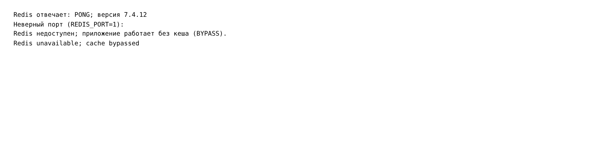

## 4. Механизм кеширования

Реализован **cache-aside**: проверить Redis → при HIT вернуть копию → при MISS прочитать БД → сохранить JSON с TTL → вернуть данные. Проверка токена и прав выполняется до кеша. Пароли и токены в Redis не сохраняются.

| Данные | Ключ (после префикса support:lab10:) | Базовый TTL |
| --- | --- | --- |
| Категории | categories:all:vC | 300 с |
| Карточка заявки | tickets:item:vT:id | 60 с |
| Страница, фильтры, поиск и COUNT | tickets:list:vT:sha256 | 60 с |
| Сводный отчёт по категориям | report:summary:tT:cC | 120 с |

T и C — версии заявок и категорий. Все параметры списка включены в нормализованный ключ: поиск, статус, категория, сортировка, порядок, страница и размер страницы. Для списков введены `page` и `limit` (до 100); тело ответа осталось массивом, общее число — в X-Total-Count. Клиент ЛР9 не меняет способ запросов и на большой базе показывает первые 100 результатов.

Дополнительная возможность — **случайный разброс TTL 0–15%**, чтобы одновременно созданные записи не истекали строго в одну секунду. Это не заменяет инвалидацию.

В `bin/cache-demo.php` медленный источник вызывается один раз: первый запрос MISS около секунды, повторный HIT почти мгновенный. Искусственная задержка есть только в этой демонстрации, в SQL и измеряемых API её нет.

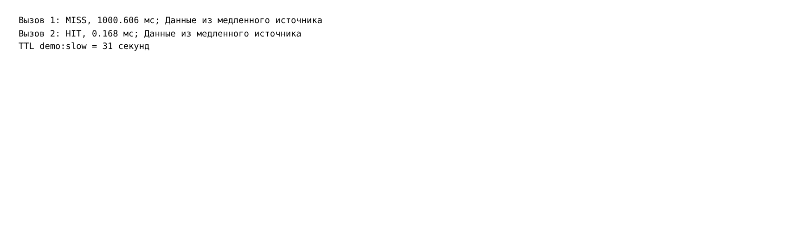
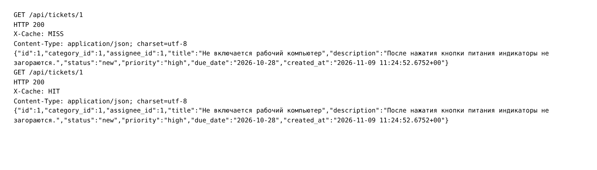
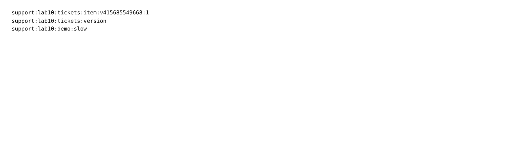

## 5. Инвалидация и устойчивость

После успешного POST/PUT/PATCH/DELETE заявки увеличивается версия заявок: списки, карточки и отчёт получают новые ключи. Изменение категории увеличивает версии категорий и заявок, чтобы обновились справочник и названия в отчёте. Изменение сотрудника также инвалидирует заявки из-за связи assignee_id. Старые ключи исчезают по TTL. Сброс и загрузка данных очищают только префикс приложения через SCAN/DEL.

Реально проверено: HIT карточки → PATCH названия → MISS с новым названием → HIT. После демонстрации исходная тема восстановлена.

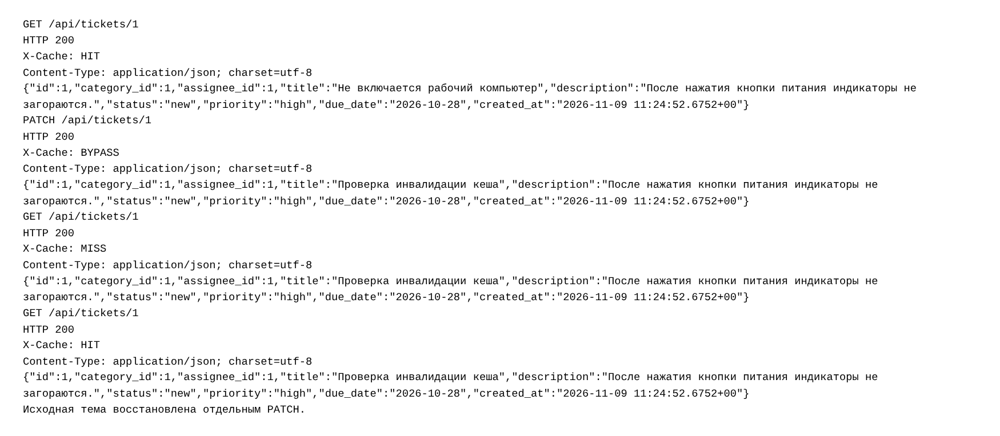

При остановке Redis авторизованный GET вернул **200 и X-Cache: BYPASS**. После восстановления — MISS, затем HIT. PostgreSQL остаётся обязательным источником данных; проверка токена также обращается к БД.

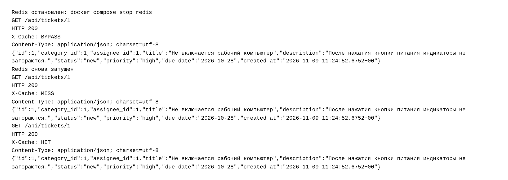

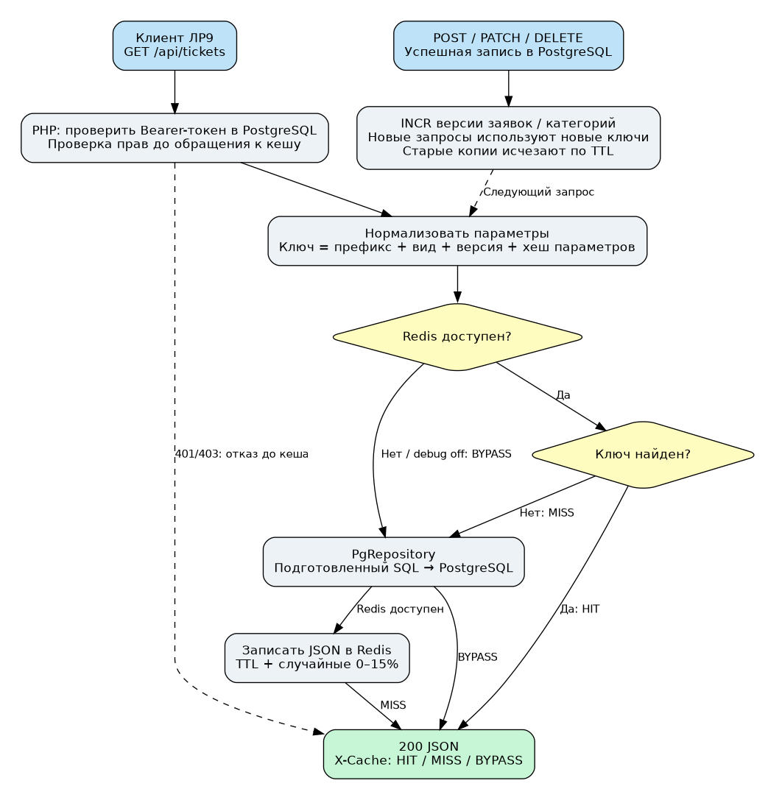

Подробные ключи, TTL, таблица инвалидации, контракт и ограничения согласованности — [docs/caching.md](docs/caching.md). Общая версия заявок инвалидирует также карточки других заявок: выбран простой механизм с более широкой областью сброса. SQL и Redis не образуют общей транзакции; при пропущенной инвалидации во время сетевого разделения устарелость ограничена TTL. Строгая распределённая согласованность не заявляется.

## 6. Сравнение производительности

Загружено **500 000 заявок** SQL-скриптом `bigdata.sql`. Выполнены два прогона семи сценариев: категории, карточка, список с COUNT, поиск, сводный отчёт, а также собственные фильтрация по статусу/категории и сортировка по теме. В каждом прогоне — 30 последовательных запросов на режим и 40 параллельных с concurrency=4; холодный MISS измерен отдельно.

Сводное среднее по 60 последовательным наблюдениям на режим:

| Сценарий | Без кеша, мс | С прогретым кешем, мс | Ускорение |
| --- | --- | --- | --- |
| Категории | 10.587 | 10.677 | 0.99× |
| Карточка заявки | 10.276 | 9.780 | 1.05× |
| Список и COUNT | 82.154 | 10.510 | 7.82× |
| Поиск подстроки | 322.377 | 11.022 | 29.25× |
| Сводный отчёт | 164.326 | 10.026 | 16.39× |
| Фильтр статуса | 44.415 | 10.753 | 4.13× |
| Сортировка по теме | 78.072 | 11.342 | 6.88× |

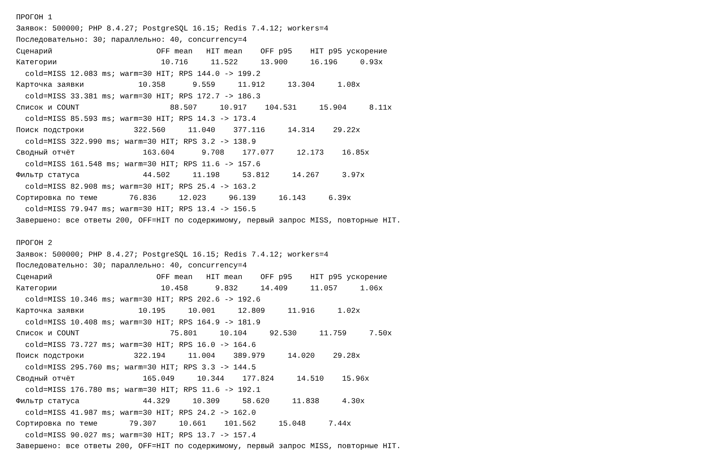
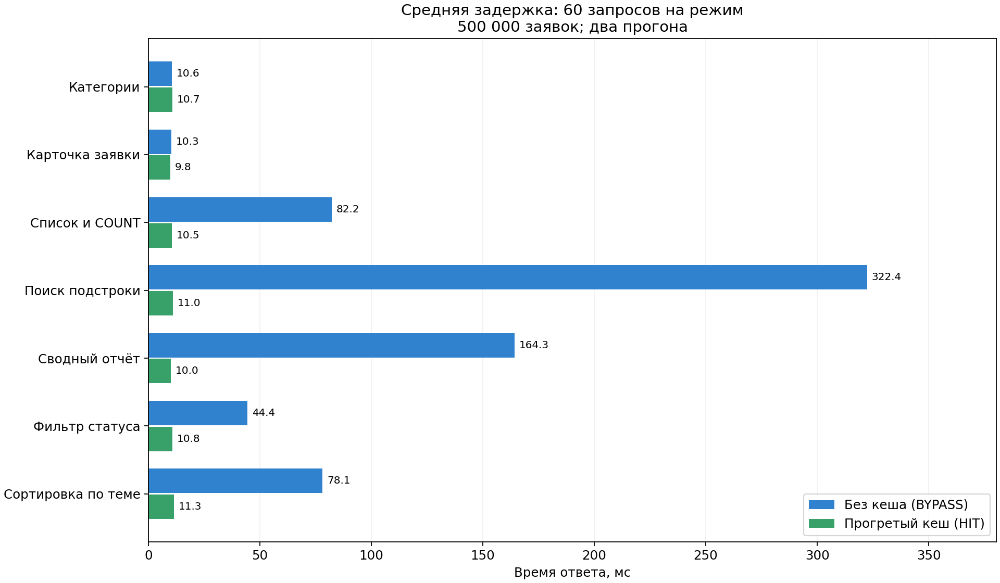
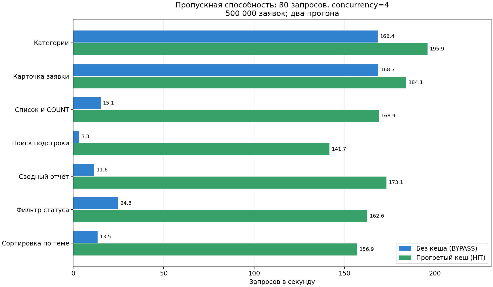

Самый большой выигрыш дал поиск подстроки; отчёт и подсчёт строк тоже заметно ускорились. Для категорий и карточки существенного выигрыша нет: SQL по маленькому справочнику или первичному ключу уже быстрый, остаются накладные расходы PHP, проверки токена и сети. Холодный MISS близок к запросу без кеша, поскольку включает чтение БД и запись Redis.

Полные таблицы среднего, p95, RPS, оба прогона и ограничения эксперимента — [docs/benchmark.md](docs/benchmark.md). Графики построены из сохранённых JSON с фактическими наблюдениями. После измерений база возвращена к шести исходным заявкам.

## 7. Тестирование

- **124 API-проверки, 0 ошибок**, включая 37 новых проверок Redis, TTL, MISS/HIT, параметров, инвалидации и доступа.
- **3 проверки хранения паролей/токенов, 0 ошибок**.
- **24 браузерных сценария, 0 ошибок**: клиент ЛР9 продолжает работать с кешируемым API.
- **2 проверки конфигурации, 0 ошибок**: при APP_DEBUG=0 заголовок обхода игнорируется; при CACHE_ENABLED=0 источник вызывается напрямую.
- **32 PHP-файла** прошли проверку синтаксиса.
- Остановка Redis и неверный порт проверены отдельно: приложение не падает, после восстановления кеш снова работает.

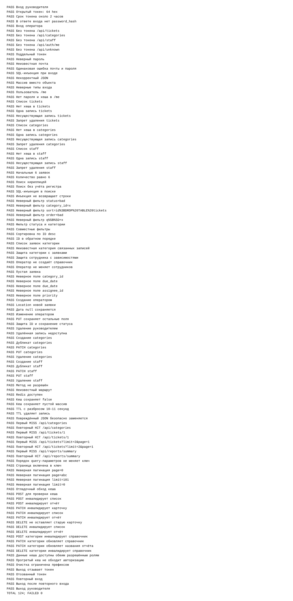

[Протокол API](docs/api-tests.txt), [браузер](docs/browser-tests.txt), [хранение хешей](docs/storage-tests.txt), [настройки кеша](docs/cache-config-tests.txt), [синтаксис](docs/php-lint.txt).

Изображения 01–08 — реальные снимки браузера с сохранённым текстовым выводом команд и HTTP-проверок. Включены UTF-8 и перенос длинных строк для читаемости; содержимое протоколов не изменялось. Это не снимки DevTools или терминала. Изображения 09–10 — графики Matplotlib, 11 — схема Graphviz. Пароли и значения токенов не публикуются.

## 8. Запуск из чистого клона

Нужны Git, Docker Engine и Docker Compose v2. Команды для bash:

```bash
git clone --branch isit-10 https://github.com/Qweflix/isit-lab1.git
cd isit-lab1/lab10/src
cp .env.example .env
# В .env заменить DB_PASSWORD локальным паролем БД.
docker compose -p lab10 up -d --build --wait
read -r -s -p 'Учебный пароль пользователей (от 8 символов): ' DEMO_PASSWORD
printf '\n'
export DEMO_PASSWORD
docker compose -p lab10 exec -T -e DEMO_PASSWORD web php84 bin/reset-db.php --confirm
docker compose -p lab10 exec -T web php84 bin/redis-check.php
docker compose -p lab10 exec -T -e DEMO_PASSWORD web php84 tests/api-tests.php
```

Открыть **http://127.0.0.1:8020/client/**. Учётные записи: `manager@example.test` и `operator@example.test`; пароль — заданный локально DEMO_PASSWORD. При занятом порте изменить APP_PORT в .env. Предыдущая ЛР9 может продолжать работать на 8000; БД и Redis изолированы Compose-проектом lab10.

В облаке со своим HTTPS-прокси может понадобиться CA при сборке:

```bash
docker build --secret id=proxy_ca,src=/etc/ssl/certs/ca-certificates.crt -t lab10-web .
docker compose -p lab10 up -d --no-build --wait
```

Redis и БД не требуют отдельной установки на хост. Клиент не требует npm или Composer. Приложению не нужны Python/Matplotlib/Graphviz: они использованы только для тестов и оформления. Для браузерных тестов установить Playwright и Chromium и выполнить из src:

```bash
python -m pip install playwright
python -m playwright install chromium
COMPOSE_PROJECT_NAME=lab10 APP_URL=http://127.0.0.1:8020 python tests/browser-tests.py
```

Тесты предназначены для отдельной учебной БД. `reset-db.php --confirm` удаляет таблицы выбранной базы; `load-bigdata.php --confirm` добавляет нагрузочные заявки. Не запускать на рабочей базе. Перед API-тестами нужен малый исходный набор.

Для измерений установить APP_DEBUG=1 в локальном .env и пересоздать web; команды приведены в [benchmark.md](docs/benchmark.md). Обычный режим — APP_DEBUG=0: клиентский заголовок X-Cache-Mode: off не отключает кеш. Остановка проекта — `docker compose -p lab10 down` из src; данные PostgreSQL сохраняются в томе.

[Фактическая проверка чистого клона](docs/clean-clone.md).

## 9. Соответствие заданию и подготовка к эксплуатации

Просмотрены все **11 страниц 5.pdf**, включая этапы, критерии, теорию и домашнюю доработку. Подключён Redis через phpredis, реализованы cache-aside, четыре вида данных, ключи со всеми параметрами, TTL и версии, инвалидация, BYPASS при отказе. Проведены два прогона семи сценариев на 500 тысячах строк, измерены среднее/p95/RPS, построены графики. Требование минимум восьми проверок кеша перекрыто 37 новыми проверками. Дополнительная возможность — разброс TTL.

Исходной заготовки с TODO и тестами преподавателя в материалах нет. Реализация выполнена непосредственно на коде ЛР9 и собственной предметной области; отдельный демонстрационный проект «Задачи команды» не запускался. Непредоставленный тестовый файл преподавателя не выдаётся за выполненный.

Для эксплуатации ещё нужны мониторинг Redis и hit rate, подбор лимита памяти, политика повторной инвалидации, HTTPS, ограничение входов и производственный PHP-сервер. Эти вопросы и ограничения описаны в [caching.md](docs/caching.md). Проверенный вариант запуска — Docker; отдельно другие версии PHP/PostgreSQL, Windows и промышленная нагрузка не проверялись.

## 10. Вывод

В ходе работы Redis подключён к системе учёта заявок, реализовано кеширование справочника, карточек, списков и отчёта. Проверены TTL, инвалидация после изменения данных и работа без Redis. Измерения на большом наборе показали заметный выигрыш дорогих повторных запросов и отсутствие существенного выигрыша там, где PostgreSQL уже отвечает быстро. Подготовлены исходники, реальные протоколы, скриншоты и диаграммы.
