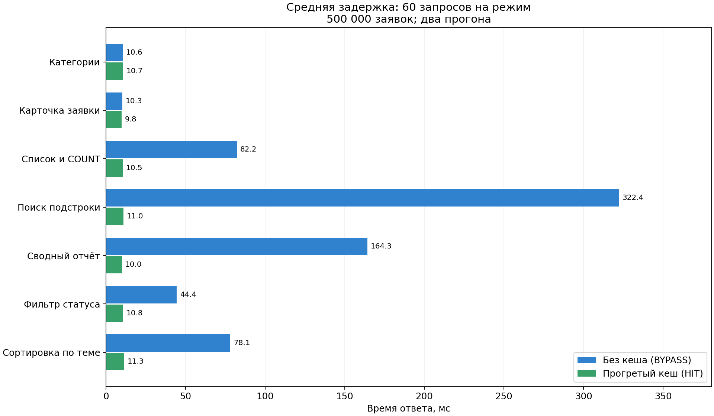
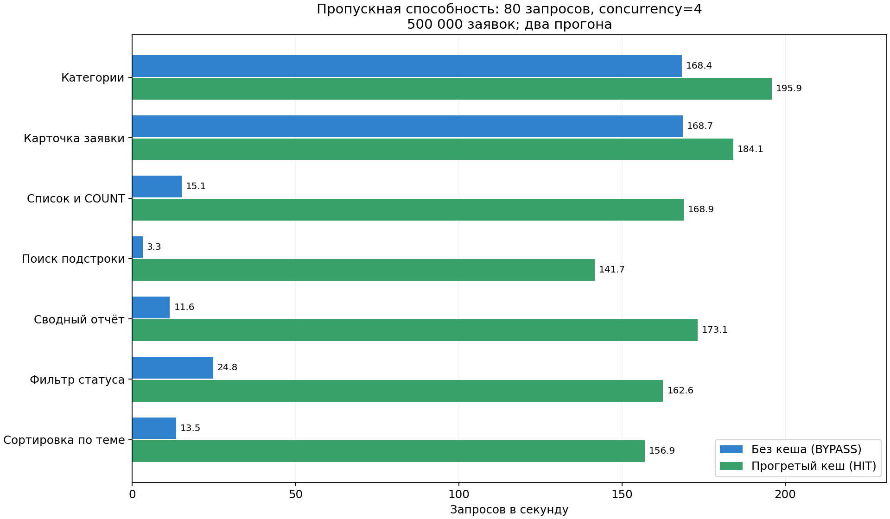

# Сравнение производительности

## 1. Методика

Эксперимент выполнен 09.11.2026 на собственной системе учёта заявок, не на демонстрационных задачах. В PostgreSQL загружено **500 000 заявок**, включая шесть исходных. Генерация: [bigdata.sql](../src/sql/bigdata.sql), запуск — [load-bigdata.php](../src/bin/load-bigdata.php). Сохранены категории, сотрудники, внешние ключи и индексы ЛР8. Для темы не добавлен pg_trgm: подстрока ILIKE намеренно остаётся примером дорогого запроса; оптимизация SQL и кеширование решают разные задачи.

Одинаковые данные, один и тот же сервер, URL и токен в пределах прогона. Между режимами данные не меняются. Приложение и клиент измерения работают в Docker; PHP 8.4.27, phpredis 6.3.0, PostgreSQL 16.15, Redis 7.4.12. Linux x86_64; среде доступны 3 логических CPU, квота cgroup — 2 CPU, память — 8 GiB. Сервер PHP имеет 4 дочерних процесса (`PHP_CLI_SERVER_WORKERS=4`) и основной процесс. Это учебный сервер, а не PHP-FPM. Условия одинаковы для обоих режимов; клиент измерения делит CPU с сервером.

Скрипт [benchmark.php](../src/bin/benchmark.php) сам выполняет вход и выход. Для каждого сценария:

1. Очищает только префикс support:lab10:.
2. Отправляет 30 последовательных запросов без кеша (`X-Cache-Mode: off`, разрешён только при APP_DEBUG=1) и проверяет BYPASS.
3. Измеряет 40 запросов без кеша с concurrency=4 через curl_multi.
4. Делает один холодный запрос с кешем и проверяет MISS.
5. Отправляет 30 последовательных прогретых запросов, каждый должен вернуть HIT.
6. Измеряет 40 прогретых запросов при concurrency=4.

Все ответы должны иметь HTTP 200. SHA-256 тел последовательных ответов сравнивается: данные OFF и HIT совпадают. В логах нет токена или пароля. Длительность запроса измеряется libcurl; RPS = число завершённых запросов / общее время параллельной серии. p95 — элемент ceil(0.95 × N) отсортированной выборки. Среднее — сумма длительностей / N. Ускорение — среднее OFF / среднее HIT.

Выполнены **два полных прогона**. На сценарий и режим в сумме 60 последовательных измерений и 80 запросов параллельной нагрузки. В каждом прогоне 987 измеряемых GET; вход/выход в это число не входят. Холодные запросы вынесены отдельно. Прогрев PostgreSQL не сбрасывался: сравнивается отсутствие кеша приложения и Redis, а не холодная ОС/БД. Во время измерений не запускались браузерные тесты или другие нагрузки этой задачи.

## 2. Прогноз до измерений

Наибольший выигрыш ожидается у подстрочного поиска и сводного GROUP BY по большой таблице. COUNT и сортировки также должны ускориться. У справочника из трёх категорий и карточки по первичному ключу существенного выигрыша не ожидается: SQL уже быстрый, остаются проверка токена, подключение к БД, PHP, JSON и сеть. Два собственных сценария сверх пяти из методички — фильтр по статусу/категории и сортировка по теме.

## 3. Сводные результаты двух прогонов

Среднее и p95 ниже рассчитаны по объединённым 60 наблюдениям. RPS — 80 запросов / сумма времени двух параллельных серий; значения p95 не усреднялись.

| Сценарий | OFF среднее, мс | HIT среднее, мс | OFF p95, мс | HIT p95, мс | OFF RPS | HIT RPS | Ускорение задержки |
| --- | --- | --- | --- | --- | --- | --- | --- |
| Категории | 10.587 | 10.677 | 13.900 | 13.664 | 168.4 | 195.9 | 0.99× |
| Карточка заявки | 10.276 | 9.780 | 12.472 | 11.916 | 168.7 | 184.1 | 1.05× |
| Список и COUNT | 82.154 | 10.510 | 102.127 | 12.588 | 15.1 | 168.9 | 7.82× |
| Поиск подстроки | 322.377 | 11.022 | 385.874 | 14.020 | 3.3 | 141.7 | 29.25× |
| Сводный отчёт | 164.326 | 10.026 | 177.077 | 13.748 | 11.6 | 173.1 | 16.39× |
| Фильтр статуса | 44.415 | 10.753 | 57.770 | 13.485 | 24.8 | 162.6 | 4.13× |
| Сортировка по теме | 78.072 | 11.342 | 96.203 | 15.144 | 13.5 | 156.9 | 6.88× |




## 4. Отдельные прогоны и холодный кеш

| Сценарий | Прогон | OFF среднее, мс | HIT среднее, мс | Холодный MISS, мс | Последовательные HIT |
| --- | --- | --- | --- | --- | --- |
| Категории | 1 | 10.716 | 11.522 | 12.083 | 30 / 30 |
| Карточка заявки | 1 | 10.358 | 9.559 | 33.381 | 30 / 30 |
| Список и COUNT | 1 | 88.507 | 10.917 | 85.593 | 30 / 30 |
| Поиск подстроки | 1 | 322.560 | 11.040 | 322.990 | 30 / 30 |
| Сводный отчёт | 1 | 163.604 | 9.708 | 161.548 | 30 / 30 |
| Фильтр статуса | 1 | 44.502 | 11.198 | 82.908 | 30 / 30 |
| Сортировка по теме | 1 | 76.836 | 12.023 | 79.947 | 30 / 30 |
| Категории | 2 | 10.458 | 9.832 | 10.346 | 30 / 30 |
| Карточка заявки | 2 | 10.195 | 10.001 | 10.408 | 30 / 30 |
| Список и COUNT | 2 | 75.801 | 10.104 | 73.727 | 30 / 30 |
| Поиск подстроки | 2 | 322.194 | 11.004 | 295.760 | 30 / 30 |
| Сводный отчёт | 2 | 165.049 | 10.344 | 176.780 | 30 / 30 |
| Фильтр статуса | 2 | 44.329 | 10.309 | 41.987 | 30 / 30 |
| Сортировка по теме | 2 | 79.307 | 10.661 | 90.027 | 30 / 30 |

Сырые наблюдения, заголовки последовательных серий, отдельные p95 и RPS: [прогон 1 JSON](benchmark-1.json), [прогон 2 JSON](benchmark-2.json). Читаемые протоколы: [1](benchmark-1.txt), [2](benchmark-2.txt). [Сводные данные](benchmark-summary.json), [исходник графиков](plot-benchmark.py). Графики построены Matplotlib по реальным измерениям, без подстановки ожидаемых значений.

## 5. Анализ

- **Поиск подстроки** дал наибольший выигрыш: повторный запрос не выполняет ILIKE и COUNT по 500 тысячам записей. Одинаковый поиск в двух прогонах ускорился примерно в 29 раз.
- **Сводный отчёт** ускорился примерно в 16 раз: Redis возвращает готовую агрегацию, PostgreSQL не выполняет повторный LEFT JOIN/GROUP BY.
- **Список с COUNT**, фильтрация и сортировка получили промежуточный выигрыш: кеш сохраняет не только страницу, но и общее число строк.
- **Карточка** почти не ускорилась: поиск по PK уже дешёвый. У категорий первый прогон даже показал ухудшение средней задержки (0.93×), а второй — небольшой выигрыш (1.06×). На трёх строках сетевые расходы Redis и изменчивость среды сопоставимы с ценой SQL. Утверждать, что любой кеш всегда ускоряет чтение, нельзя.
- **Первый MISS** включает запрос БД и запись Redis. Он обычно близок к OFF и может быть медленнее. Отдельный холодный запрос — одно наблюдение; его колебания не трактуются как устойчивый эффект.
- RPS и задержка отдельного запроса — разные характеристики. В параллельном режиме конкурируют CPU и подключения к БД; поэтому рост RPS не обязан совпадать с отношением последовательных средних. Малые расхождения быстрых сценариев между прогонами отражают шум, а не новый эффект.

Прогноз подтвердился для дорогих запросов. Если данные меняются каждую секунду, частая инвалидация уменьшит долю HIT; при низкой повторяемости запросов новые параметры будут занимать память без пользы. Для таких случаев следует уменьшить область инвалидации и TTL, ограничивать число вариантов, оптимизировать SQL и измерять hit rate. Данные, где недопустима устарелость, читают из источника истины. Для редких запросов по PK или маленьких таблиц Redis может не окупать накладные расходы.

Это два учебных прогона, а не нагрузочная сертификация. RPS относится к коротким сериям на этой среде. Не измерялись длительная нагрузка, несколько хостов, отказ PostgreSQL под большой нагрузкой или производственный PHP-FPM.

## 6. Воспроизведение

Из `lab10/src`, после настройки .env и запуска (README). Для измерения задать **APP_DEBUG=1** в локальном .env и пересоздать web. DEMO_PASSWORD должен совпадать с паролем, заданным при reset-db.

```bash
docker compose -p lab10 up -d --no-build --wait
docker compose -p lab10 exec -T web php84 bin/load-bigdata.php --confirm
docker compose -p lab10 exec -T -e DEMO_PASSWORD web php84 bin/benchmark.php --requests=30 --parallel=40 --concurrency=4 --output=/tmp/benchmark-1.json
docker compose -p lab10 exec -T -e DEMO_PASSWORD web php84 bin/benchmark.php --requests=30 --parallel=40 --concurrency=4 --output=/tmp/benchmark-2.json
```

Для сохранения JSON на хост использовать `docker compose -p lab10 cp web:/tmp/benchmark-1.json ./benchmark-1.json`; исходный каталог монтируется read-only, поэтому скрипт пишет в /tmp контейнера. Генерация предназначена только для отдельной учебной базы. После измерений восстановить малый набор (удалит нагрузочные записи и создаст пользователей заново):

```bash
docker compose -p lab10 exec -T -e DEMO_PASSWORD web php84 bin/reset-db.php --confirm
docker compose -p lab10 exec -T -e DEMO_PASSWORD web php84 tests/api-tests.php
```

Фактически база возвращена к шести начальным заявкам; 124 API-проверки после сброса выполнены повторно.
