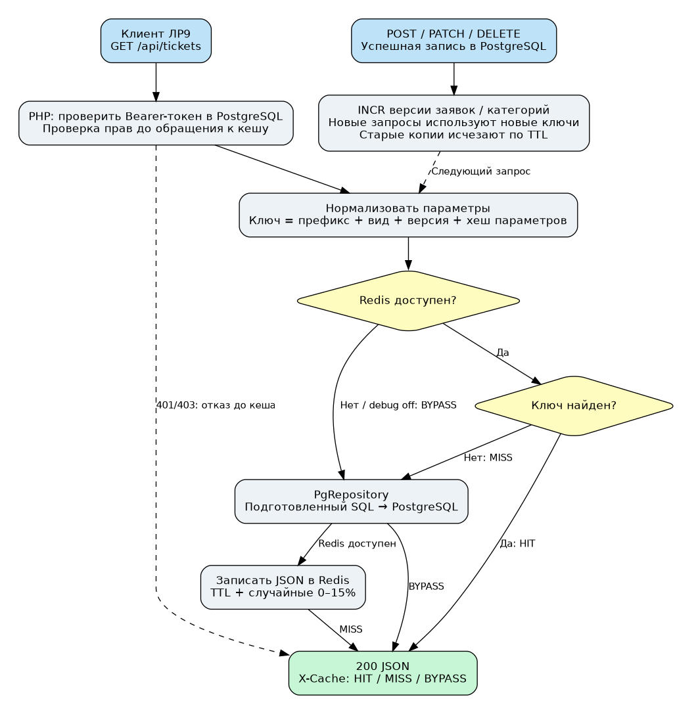

# Кеширование системы учёта заявок

## 1. Выбранные данные

Приложение перенесено из `lab9/src` без смены предметной области: заявки, категории, сотрудники и семь таблиц ЛР8. Добавлены Redis 7 и расширение phpredis. Источник истины — PostgreSQL, Redis хранит только копии данных.

| Вид | Почему кешируем | Ключ без префикса | TTL |
| --- | --- | --- | --- |
| Категории | Небольшой справочник читается при каждом входе, меняется редко | `categories:all:v<C>` | 300–345 с |
| Карточка заявки | Частые повторные просмотры; запрос по PK уже быстрый, ожидаемый выигрыш небольшой | `tickets:item:v<T>:<id>` | 60–69 с |
| Страница заявок и общее число | LIMIT/OFFSET, сортировка, поиск и COUNT на большой таблице | `tickets:list:v<T>:<sha256>` | 60–69 с |
| Отчёт по категориям | LEFT JOIN, GROUP BY и подсчёты по всей таблице | `report:summary:t<T>:c<C>` | 120–138 с |

Префикс всех ключей — **`support:lab10:`**. Версии `tickets:version` и `categories:version` не имеют TTL; это два небольших служебных ключа. Начальная версия случайная, последующие изменения увеличивают её командой INCR. Если отдельно удалить номер версии, новая случайная версия не откроет старые значения. В Redis задано `noeviction`, чтобы счётчик версии не вытеснялся отдельно от данных.

Роли имеют одинаковое право чтения этих ресурсов, поэтому ключ не содержит пользователя. Перед любым обращением к кешу сервер проверяет Bearer-токен и срок в PostgreSQL. Токены, пароли и результат проверки прав не кешируются. Прогретый кеш не позволяет обойти 401/403.

## 2. Алгоритм cache-aside

1. Сформировать ключ из вида данных, версии и параметров.
2. Если Redis доступен и содержит корректное значение — декодировать JSON и вернуть **HIT**.
3. При промахе запросить PostgreSQL через PDO.
4. Сохранить результат в Redis командой SETEX и вернуть **MISS**.
5. Если Redis недоступен или явно включён разрешённый отладочный обход — запросить PostgreSQL и вернуть **BYPASS**.

В ответах кешируемых GET есть `X-Cache: HIT`, `MISS` или `BYPASS`. Для остальных API заголовок не обязателен; записи используют BYPASS. Пустые массивы и false корректно отличаются от отсутствующего ключа. Повреждённый JSON считается промахом и заменяется свежими данными. Неуспешный запрос БД не сохраняется как успешный результат.

Класс `app/Core/Cache.php` содержит подключение с connect/read timeout 0,3 с, get/set/remember, версии, инвалидацию и очистку префикса. После первой ошибки Redis в одном запросе повторных подключений не выполняется. Ошибки логируются без токенов и содержимого записей. Redis не является обязательной зависимостью запуска web: при его отказе приложение работает с БД.



Исходник схемы: [cache-flow.dot](cache-flow.dot).

## 3. Параметры и контракт API

Список заявок сохраняет JSON-массив ЛР9. Добавлена пагинация: `page` (1–1000000), `limit` (1–100, по умолчанию 100). Полное число совпадений передаётся заголовком **X-Total-Count**; оно кешируется вместе с items. Клиент ЛР9 продолжает работать, на большой базе показывает первые 100 результатов; следующие страницы доступны через API. В интерфейсе не добавлялась отдельная навигация по страницам.

Параметры `q`, `status`, `category_id`, `sort`, `order`, `page`, `limit` нормализуются в массив с фиксированным порядком полей. Из JSON этого массива вычисляется SHA-256. Поэтому перестановка параметров в URL не меняет ключ, а другая страница, категория, сортировка или поисковая строка получает отдельный ключ. Неизвестные параметры не влияют на SQL и не включаются в ключ.

Значения передаются в PDO параметрами. Имена столбцов сортировки выбираются из белого списка. SQL и формат записей ЛР9 сохранены. Добавлен защищённый **GET `/api/reports/summary`**: массив объектов с `category_id`, `category_title`, `total`, `new`, `in_progress`, `done`, `unassigned`. Обе роли могут читать отчёт.

Примеры:

```text
GET /api/categories
GET /api/tickets/1
GET /api/tickets?limit=100&page=2&status=new
GET /api/tickets?q=сетевого&sort=title
GET /api/reports/summary
Authorization: Bearer <токен текущего пользователя>
```

Вход, выход, права и остальные CRUD-маршруты соответствуют [ЛР9](../../lab9/docs/api.md). HTTP 204 не содержит тела, 401 возвращает к входу, 403 запрещает действие, 422 содержит errors по полям.

## 4. Инвалидация

Инвалидация вызывается **после успешной записи в PostgreSQL**, а не до неё. Неуспешный UPDATE/DELETE или ошибка ограничения не меняет версии.

| Изменение | Действие | Результат |
| --- | --- | --- |
| POST/PUT/PATCH/DELETE заявки | INCR tickets:version | Все варианты списка, карточки и отчёт читаются по новым ключам |
| POST/PUT/PATCH/DELETE категории | INCR categories:version и tickets:version | Справочник, отчёт с названием категории и связанные списки обновлены |
| Изменение/удаление сотрудника | INCR tickets:version | В карточках не остаётся прежний assignee_id после ON DELETE SET NULL |
| reset-db.php / load-bigdata.php | SCAN + DEL только support:lab10:* | Данные прежней базы не используются |
| Истечение TTL | Redis удаляет значение | Следующее чтение — MISS |

Применена общая версия заявок: изменение одной записи инвалидирует также карточки других заявок. Это более широкая инвалидация, чем удаление одной карточки, зато механизм остаётся простым и старый параллельный загрузчик не может записать данные в новую версию ключа. Старые значения не удаляются массовым KEYS на каждом изменении, а исчезают по TTL. Очистка префикса нужна только для учебного сброса, она не использует FLUSHDB.

Ограничение cache-aside: фиксация SQL и изменение версии Redis не являются общей распределённой транзакцией. Между ними есть короткое окно; если Redis теряет связь именно во время записи и затем возвращается со старой памятью, копия может оставаться прежней до TTL. В проверке stop/start используется Redis без сохранения данных, поэтому после восстановления кеш пуст. Для строгой согласованности при сетевых разделениях потребуются outbox/повторная инвалидация или версия в PostgreSQL; в учебную реализацию это не добавлено. При внешних изменениях БД в обход API также действует только TTL.

## 5. Дополнительная возможность: разброс TTL

К базовому TTL добавляется целое случайное число от 0 до floor(15% TTL). Записи, созданные одновременно, истекают в разное время. Это уменьшает синхронные промахи, но не предотвращает одновременное заполнение одного популярного ключа. Блокировка stampede не реализована. Автотест проверяет диапазон TTL и фактическое истечение короткой записи.

## 6. Redis: проверенные команды

Из `lab10/src`:

```bash
docker compose -p lab10 exec -T redis redis-cli PING
docker compose -p lab10 exec -T web php84 bin/redis-check.php
docker compose -p lab10 exec -T web php84 bin/cache-demo.php
docker compose -p lab10 exec -T redis redis-cli --scan --pattern 'support:lab10:*'
docker compose -p lab10 exec -T redis redis-cli TTL support:lab10:demo:slow
docker compose -p lab10 stop redis
# Повторить авторизованный GET: ожидается 200 и X-Cache: BYPASS.
docker compose -p lab10 up -d --wait redis
```

Для измерений нужен APP_DEBUG=1. Только в этом режиме заголовок `X-Cache-Mode: off` отключает кеш в запросе. По умолчанию APP_DEBUG=0, заголовок игнорируется. Он не отключает проверку авторизации. При CACHE_ENABLED=0 кеш отключён полностью.

## 7. Проверки и подготовка к эксплуатации

В [api-tests.txt](api-tests.txt) — 124 успешные проверки, из них 37 новых: подключение, false/пустой массив, TTL, повреждённый JSON, MISS/HIT четырёх видов данных, нормализация параметров, разные страницы, инвалидация после POST/PATCH/DELETE, актуальность названия категории в отчёте, права и очистка только своего префикса. Исходный тестовый шаблон преподавателя не предоставлен; использован и расширен реальный тестовый набор ЛР9.

Дополнительно реально выполнены неверный порт Redis, stop/start с ответами BYPASS/MISS/HIT, 24 браузерных сценария и проверки хранения хешей. Протоколы: [redis-check](redis-check.txt), [отказ и восстановление](redis-down.txt), [браузер](browser-tests.txt).

Для эксплуатации ещё нужны: мониторинг latency/ошибок Redis и hit rate; подбор maxmemory и стратегии вытеснения с учётом версий; контроль числа вариантов ключей; HTTPS, ограничение входов и защита токенов; отключение debug; закрытая сеть Redis и PostgreSQL; решение согласованности при пропущенной инвалидации; сервер PHP-FPM вместо учебного встроенного сервера. Redis здесь не публикует порт хоста, ограничен 64 MiB, работает без persistence как восстанавливаемый кеш. PostgreSQL также не публикует порт хоста.
