# Лабораторная работа №11. Асинхронная обработка данных

## 1. Цель работы

Подключить очередь Redis к системе учёта заявок пользователей, выполнять уведомления и формирование CSV-отчётов отдельным PHP-воркером, проверить повторы и восстановление, сравнить время HTTP-ответа с синхронным выполнением.

## 2. Исходное приложение и связь с предыдущими работами

Предметная область сохранена с ЛР1, ЛР7 и ЛР8: заявки пользователей (`tickets`), категории (`categories`) и сотрудники поддержки (`staff`). PHP-маршрутизатор, HTML-страницы, контроллеры, API-валидация и стиль сообщений скопированы из ЛР7 в `lab11/src`. SQL-схема и начальные данные PostgreSQL перенесены из ЛР8. В ЛР8 PHP-приложение ещё не подключалось к БД, поэтому в этой работе JSON-репозитории заменены репозиториями PostgreSQL с теми же методами. ЛР9 и ЛР10 в полученной ветке отсутствуют; их компоненты не выдаются за существующие. Предыдущие лабораторные не изменялись.

## 3. Технологии и структура

PHP 8.3 (`pdo_pgsql`, `redis`, `mbstring`, `pcntl`), PostgreSQL 16, Redis 7, Docker Compose. Основные части:

```text
lab11/
├── README.md
├── docs/queue.md                 # Устройство и ограничения очереди
├── docs/evidence/               # Фактический вывод проверок и измерения
├── images/                      # 9 PNG по журналам, диаграмма и схема
└── src/
    ├── app/Core/Queue.php       # push, reserve, ack, retry, recover
    ├── app/Jobs/                # DemoJob, NotificationJob, ReportJob
    ├── app/Controllers/Api/     # Заявки, категории, сотрудники, отчёты, уведомления
    ├── app/Models/              # Репозитории PostgreSQL
    ├── bin/                     # Воркер, CLI-проверки, измерения
    ├── sql/                     # Схема ЛР8, seed, async, bigdata
    ├── tests/api-tests.php
    ├── storage/reports/
    ├── Dockerfile
    └── docker-compose.yml
```

Пример `рез2.pdf` использован для размещения `lab11`, `src`, `docs`, `images`, `bin`, `Jobs` и тестов. Файлы шаблона, не нужные собственному приложению (например, `Cache.php` и отдельный JS-клиент), не добавлялись пустыми. Исходный HTML-интерфейс ЛР7 сохранён.

## 4. Установка и запуск

Из корня репозитория:

```bash
cd lab11/src
docker compose up -d --build db redis app
docker compose ps
docker compose exec app php bin/redis-check.php
docker compose exec app php bin/queue-check.php
docker compose exec app php tests/api-tests.php
docker compose up -d worker
```

При первом запуске PostgreSQL автоматически выполняет `schema.sql`, `seed.sql`, `async.sql`. Сервер доступен на `http://localhost:8088/`, PostgreSQL — порт 5433, Redis — 6380. При занятых портах можно задать `APP_PORT`, `DB_PORT`, `REDIS_PORT` перед `docker compose up`; внутри контейнеров конфигурация остаётся согласованной. Отдельный воркер стартует как сервис `worker`; журнал: `docker compose logs -f worker`.

Для чистого повторения опытов в учебной БД:

```bash
docker compose stop worker
docker compose exec app php bin/reset-db.php
docker compose exec app php tests/api-tests.php
docker compose up -d worker
```

`reset-db.php` удаляет учебные записи. Проверки очереди и API выполняются при остановленном воркере, чтобы он не забрал их контрольные задания. Сборка Dockerfile проверена в данной среде; исходный архив расширения `redis` версии 6.2.0 помещён в `src/vendor`, чтобы сборка расширения не зависела от доступности PECL. Для работы с API используется Basic Auth: `alexey@example.test`, `maria@example.test`, `dmitry@example.test`, `operator@example.test`; пароль для локального стенда — `lab11-demo`. HTML-страницы и прежние маршруты чтения открываются как в ЛР7.

## 5. Очередь Redis и формат задания

Новые задачи записываются слева в `queue:default`, а `BLMOVE RIGHT LEFT` переносит старую задачу в `queue:default:processing`. После успешной обработки `ack` удаляет её по точному содержимому. Повторы ждут в `queue:default:delayed`, задачи после исчерпания попыток попадают в `queue:default:dead`. JSON содержит `id`, `type`, короткий `payload`, `attempts`, `created_at`; после ошибки — `error`. Подробности и команды Redis CLI приведены в [docs/queue.md](docs/queue.md).

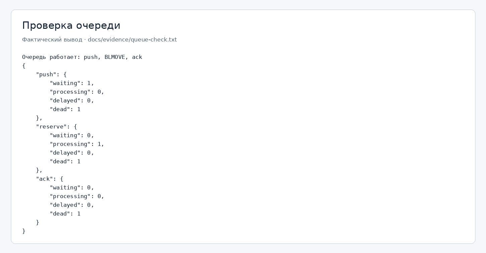

Вывод настоящего `queue-check.php`: после `push` ожидает одна задача, после `BLMOVE` она в обработке, после `ack` список обработки пуст. [Исходный журнал](docs/evidence/queue-check.txt).

## 6. Постановка задания и уведомления

При `PATCH /api/tickets/{id}` со сменой статуса контроллер обновляет заявку, ставит задание `notification` и отвечает `200` с `X-Job-Id`. Если статус не менялся, задание не создаётся. Воркер выбирает руководителей — владельцев категорий из БД ЛР8 — и записывает уведомления всем, кроме автора изменения. Ограничение `UNIQUE(job_id, staff_id)` и `ON CONFLICT DO NOTHING` исключают дубли при повторном выполнении. Просмотр своих уведомлений: `GET /api/notifications` с Basic Auth.

```bash
curl -i -u maria@example.test:lab11-demo -X PATCH http://localhost:8088/api/tickets/2 \
  -H 'Content-Type: application/json' --data '{"status":"done"}'
docker compose exec redis redis-cli LRANGE queue:default 0 -1
```

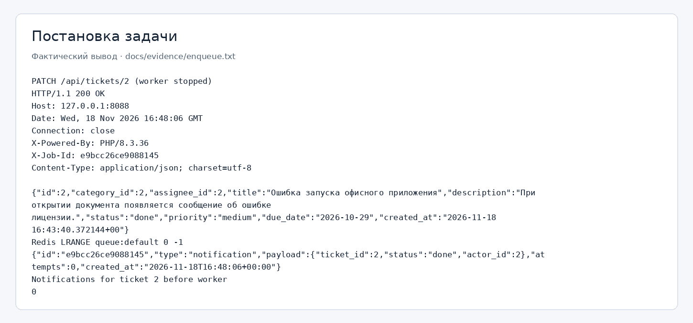

На фактическом выводе при остановленном воркере HTTP-ответ уже получен, Redis хранит JSON, уведомлений ещё нет. [Исходный журнал](docs/evidence/enqueue.txt).

## 7. Воркер, подтверждение, повторы и остановка

`bin/worker.php` вызывает `recover()`, переносит готовые отложенные задачи, ждёт `BLMOVE`, выбирает обработчик через `Jobs::handle()`, выполняет его и делает `ack`. В журнале указаны ID, тип и время выполнения. Для опытов: `docker compose stop worker`, затем `docker compose exec app php bin/queue-demo.php` и `docker compose run --rm --no-deps worker php bin/worker.php --drain`.

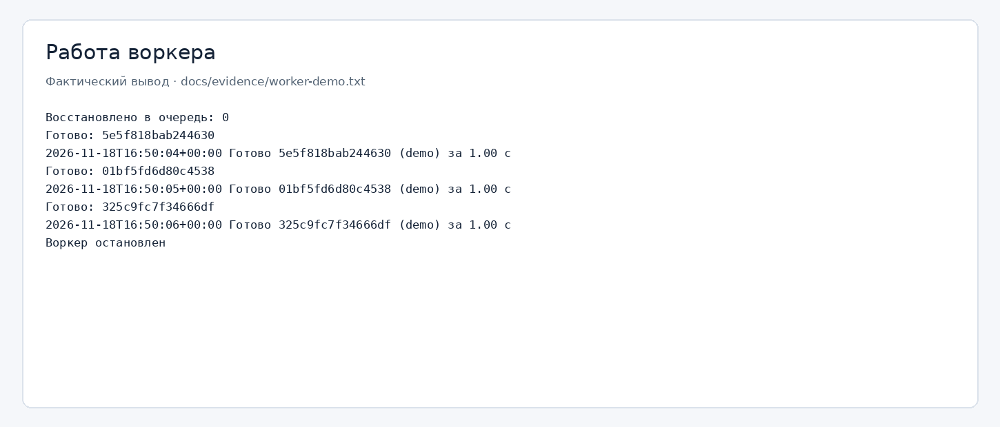

Три обычные демонстрационные задачи выполнены по 1 с. [Исходный журнал](docs/evidence/worker-demo.txt).

При ошибке сохраняется число попыток. После первого и второго отказа паузы составляют 2 и 4 с; после третьего задача переносится в `dead`. Нестабильная задача `--flaky` успешно прошла на третьей попытке. Этот порядок соответствует сценарию проверки методички, где после трёх неудач задача становится «мёртвой».

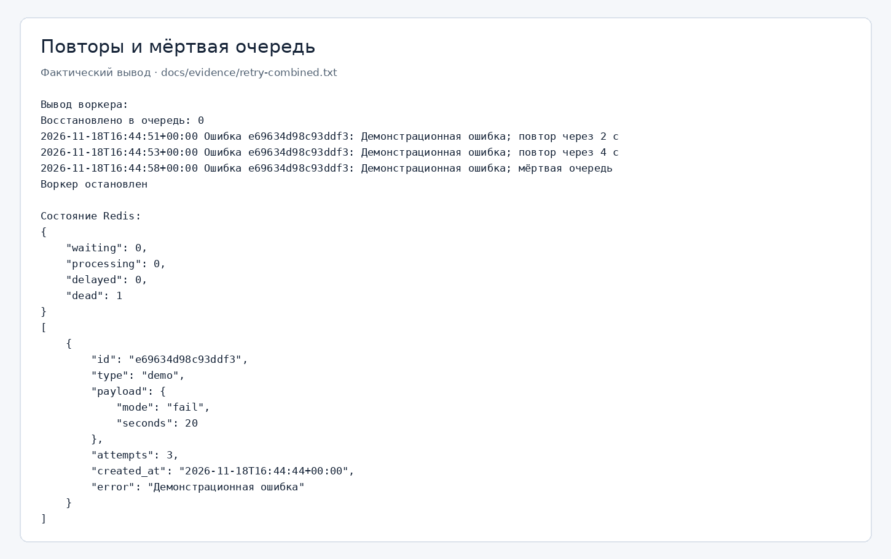

[Вывод воркера](docs/evidence/retry-worker.txt), [состояние Redis](docs/evidence/retry-dead.txt), [успешная нестабильная задача](docs/evidence/flaky-worker.txt).

После принудительного `SIGKILL` задача осталась в `processing`; новый воркер вернул и выполнил её. При `SIGTERM` текущая 20-секундная задача завершилась, затем воркер вышел с пустым `processing`.

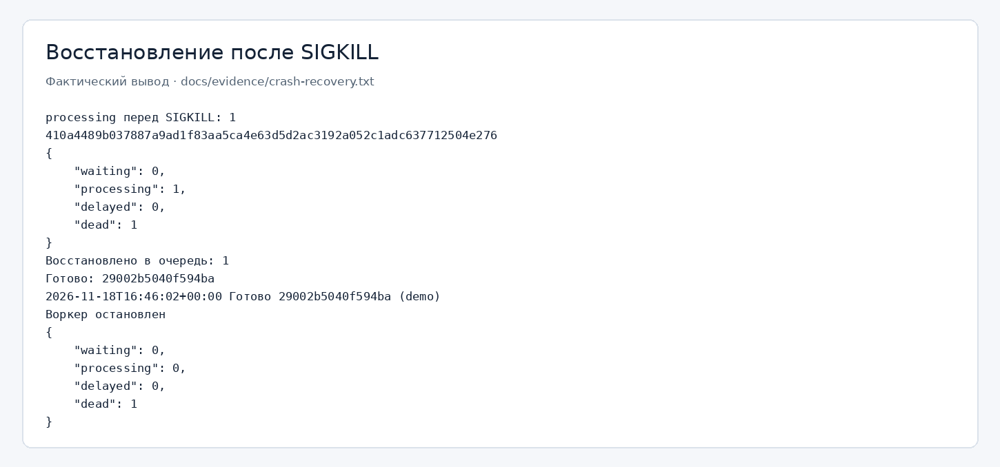

[Журнал аварийного завершения](docs/evidence/crash-recovery.txt) и [журнал корректной остановки](docs/evidence/graceful-stop.txt). Работа нескольких воркеров одновременно в этой учебной реализации не поддерживается: `recover()` при старте другого процесса может вернуть ещё активную задачу. Это и другие ограничения описаны в [docs/queue.md](docs/queue.md).

## 8. Вторая фоновая операция: CSV-отчёт

`POST /api/reports` создаёт строку `reports`, кладёт `report` в Redis и немедленно возвращает `202 Accepted` с `Location: /api/reports/{id}`. `GET /api/reports/{id}` показывает `queued`, `processing`, `done` или `failed`, а также причину ошибки. Отчёт видит заказчик или руководитель. `GET /api/reports/{id}/download` до готовности возвращает `409`, после готовности отдаёт CSV. Воркер выбирает заявки с категориями и исполнителями из PostgreSQL и сохраняет файл в `storage/reports/`. В CSV есть UTF‑8 BOM и разделитель `;` для Excel и кириллицы. Повтор уже готового задания не создаёт файл заново.

```bash
curl -i -u alexey@example.test:lab11-demo -X POST http://localhost:8088/api/reports \
  -H 'Content-Type: application/json' --data '{}'
curl -u alexey@example.test:lab11-demo http://localhost:8088/api/reports/1
curl -u alexey@example.test:lab11-demo -o report.csv http://localhost:8088/api/reports/1/download
```

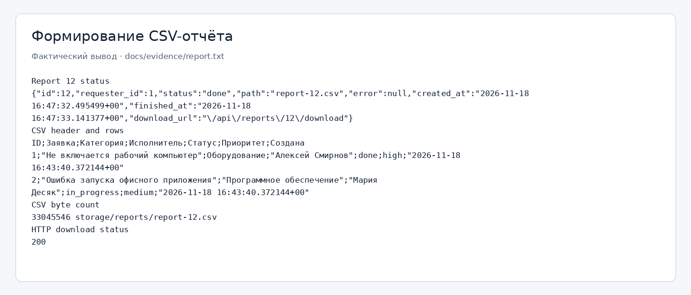

Фактический отчёт по 200 006 заявкам содержал кириллицу и скачивался с кодом `200`; размер CSV составил 33 045 546 байт. [Исходный журнал](docs/evidence/report.txt).

## 9. Тестирование

После сброса учебной БД запущен `php tests/api-tests.php`: **26 из 26 проверок успешно**. Проверены прежний маршрут заявок, авторизация, очередь, FIFO, `BLMOVE` и `ack`, смена статуса и отсутствие задачи при обычной правке, недублирующиеся уведомления, права доступа, статусы отчёта, CSV с BOM, синхронный режим и сохранение причины ошибки записи. Сверх базовых сценариев добавлены проверки правки без смены статуса, текста уведомления с названием заявки, запрета чужого отчёта, FIFO и повтора готового отчёта. Приложенные к методичке 114 автопроверок отсутствовали в этом репозитории, поэтому число 117 не заявляется.

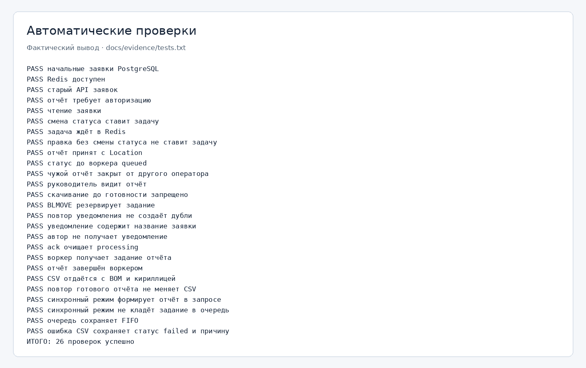

[Полный вывод](docs/evidence/tests.txt). Сценарии отказов и сигналов проверены отдельно, как описано в разделе 7. Предыдущие лабораторные не менялись; их собственные наборы в этом запуске не исполнялись.

## 10. Измерение синхронного и асинхронного режимов

После `php bin/load-bigdata.php` база содержала **200 006 заявок**. `php bin/bench-async.php` пять раз заказал отчёт с очередью и пять раз с `X-Queue-Mode: sync`. Во время асинхронных прогонов отдельный воркер работал. Таблица — фактический вывод в миллисекундах:

| Режим | Прогон | HTTP-ответ | Ожидание после ответа | Всего |
| --- | ---: | ---: | ---: | ---: |
| async | 1 | 15,87 | 706,98 | 722,85 |
| async | 2 | 23,46 | 727,58 | 751,04 |
| async | 3 | 14,71 | 739,57 | 754,29 |
| async | 4 | 14,57 | 742,33 | 756,90 |
| async | 5 | 16,30 | 586,84 | 603,14 |
| sync | 1 | 731,34 | 0,02 | 731,36 |
| sync | 2 | 2726,36 | 0,02 | 2726,38 |
| sync | 3 | 511,72 | 0,13 | 511,85 |
| sync | 4 | 635,83 | 0,02 | 635,85 |
| sync | 5 | 579,68 | 0,02 | 579,70 |

Медиана HTTP-ответа: **15,87 мс** с очередью и **635,83 мс** без неё; медиана полного времени: **751,04 мс** и **635,85 мс** соответственно. Очередь сократила ожидание ответа примерно в 40 раз, но сама работа не ускорилась: в полном времени появились ожидание воркера и накладные расходы. Пользователь получает результат позже и должен опрашивать `Location`; системе необходим работающий воркер и обработка сбоев. На маленьком наборе из шести заявок синхронный режим даже отвечал быстрее, что также было измерено до загрузки большой выборки.

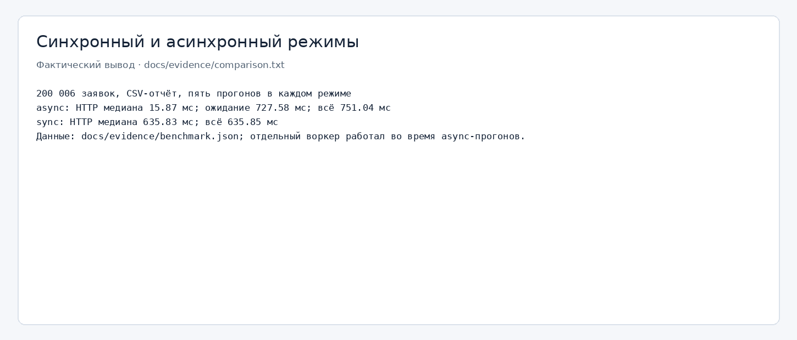

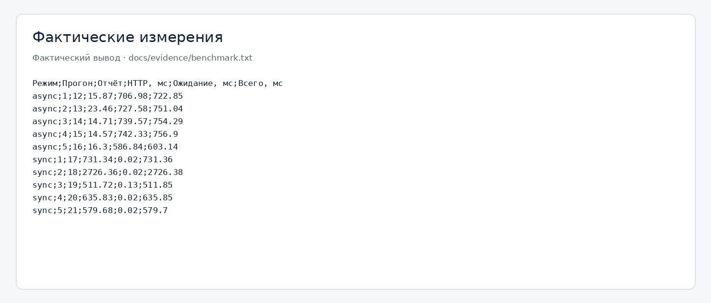

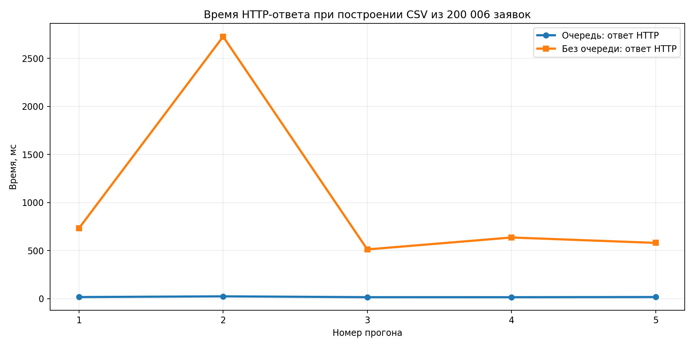

[Табличный вывод](docs/evidence/benchmark.txt), [машиночитаемые данные](docs/evidence/benchmark.json), [скрипт](src/bin/bench-async.php). Диаграмма построена по этим измерениям.

## 11. Схема движения задачи

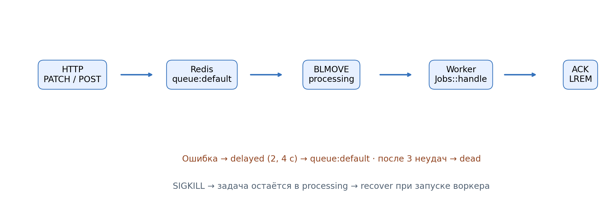

Схема показывает постановку, `BLMOVE`, обработку, подтверждение, повтор и восстановление. Она построена программно; это пояснение алгоритма, а не снимок работающего терминала. Первые девять PNG — визуализация **сохранённого фактического вывода**, с ссылкой на исходный журнал под каждым изображением; они не выдаются за фотографии терминала. Генератор изображений: [docs/render_evidence.py](docs/render_evidence.py).

## 12. Вывод

Очередь и отдельный воркер встроены в существующую систему учёта заявок. Уведомления перестали задерживать HTTP-ответ, отчёт создаётся в фоне и доступен после проверки статуса. Подтверждение, повторы, мёртвая очередь, восстановление после `SIGKILL`, корректная остановка и идемпотентность проверены фактическими запусками. Ограничения учебной реализации: один активный воркер и отсутствие общей транзакции между PostgreSQL и Redis.

[Таблица соответствия обязательным пунктам методички](docs/requirements.md).
